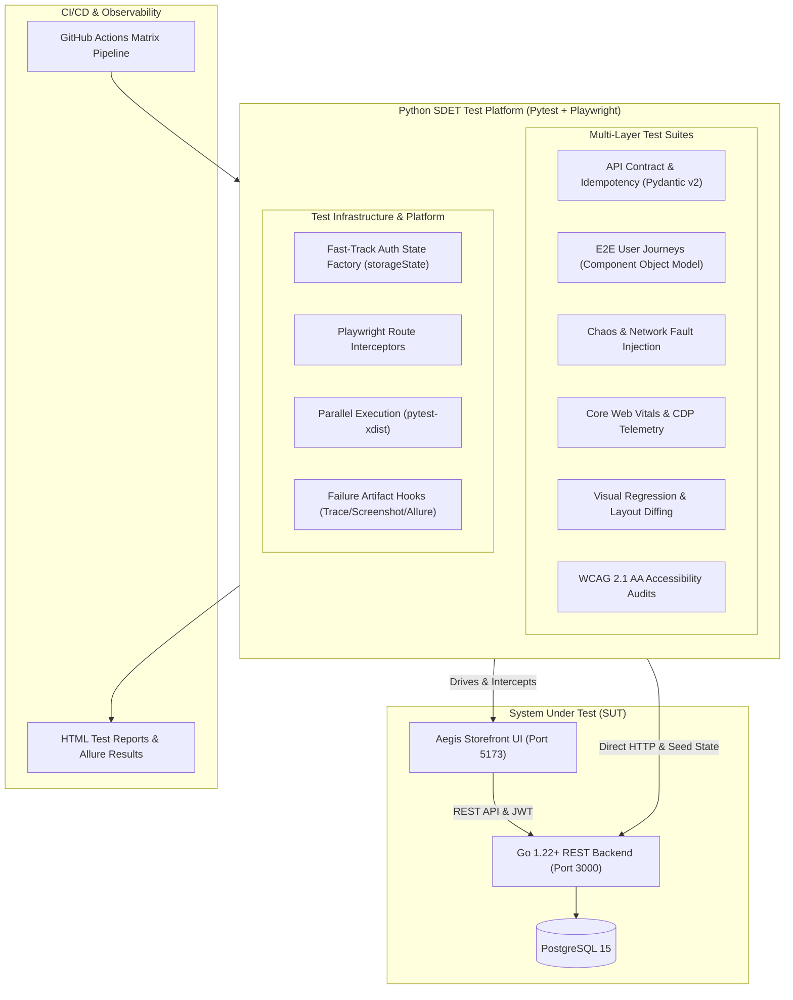

# Enterprise Python SDET Test Automation Platform & Storefront - Aegis

[](https://python.org)
[](https://playwright.dev/python/)
[](https://pytest.org)
[](https://qameta.io/allure-report/)
[](https://docs.pydantic.dev/)
[](https://www.docker.com)
[](https://github.com/features/actions)

An enterprise-grade, multi-layered quality engineering platform and modern e-commerce storefront built with **Python 3.12+**, **Playwright**, **Pytest**, **Allure Reporting**, and **Pydantic v2**.

> [!NOTE]
> This test infrastructure and frontend is built upon my [Go E-Commerce Shop Backend](https://github.com/maxbruk/Go-E-commerce-Shop-Backend) project. It serves as the full-stack validation harness for high-concurrency ACID transactions, `Idempotency-Key` duplicate billing protections, role-based access control, and telemetry percentiles.

---

## Why this project?

Most SDET portfolios feature trivial scripts clicking through demo sites (`SauceDemo` or `TodoMVC`). This platform solves real-world test engineering challenges found in high-scale tech companies like **Apple**, **Stripe**, and **Netflix**:

- **Allure Test Telemetry & Rich Reporting**: Epics, Features, User Stories, Severity levels, step-by-step audit logs, and automatic failure screenshot / trace attachments.
- **Eliminating Slow UI Authentication Loops**: Bypasses slow 5-second UI form logins for every test by authenticating via API in **50ms** and injecting pre-signed JWT sessions directly into Playwright browser contexts (`storageState`).
- **Component Object Model (COM)**: Replaces bloated monolithic Page Objects with decoupled, reusable component abstractions (`HeaderComponent`, `CartDrawerComponent`, `CheckoutModalComponent`, `AuthModalComponent`).
- **Chaos Engineering & Fault Injection**: Intercepts browser network routes (`page.route()`) to simulate HTTP 500 server crashes, HTTP 429 rate limit throttles, simulated 3G latency, and offline mode.
- **Performance Profiling via Chrome DevTools Protocol (CDP)**: Hooks into live Chromium CDP sessions to assert Core Web Vitals thresholds (**Largest Contentful Paint < 2.5s**, **Cumulative Layout Shift < 0.1**, and JS heap allocation limits).
- **Automated WCAG 2.1 AA Accessibility Scanning**: Audits all views for missing ARIA labels, unlabelled buttons, and duplicate DOM IDs during CI runs.
- **Pixel-Level Visual Regression Differ**: Detects layout drifts across desktop and mobile viewports with perceptual diffing.
- **Live Real-Time Polling & ACID Settlement**: Integrates directly with the live Go 1.22+ PostgreSQL backend on port 3000 with real-time price synchronization and idempotency protections.

---

## Architecture and System Design



### Directory Structure

```text
├── frontend/                     # Minimalist, modern storefront web application (Aegis Store)
│   ├── index.html                # Semantic HTML5 layout with data-testid selectors
│   ├── app.js                    # Catalog rendering, cart drawer, checkout, auth state, live polling
│   └── styles.css                # Modern design system (neutral palette, zero AI gradients, Inter font)
├── framework/                    # Reusable Core SDET Framework
│   ├── api/                      # Type-safe HTTP Client & Pydantic v2 Schemas
│   │   ├── client.py             # Base HTTP client with automatic timing & error handling
│   │   ├── auth_api.py           # Auth endpoints (/api/v1/auth)
│   │   ├── products_api.py       # Catalog & admin endpoints (/api/v1/products)
│   │   ├── cart_api.py           # Shopping cart endpoints (/api/v1/cart)
│   │   ├── orders_api.py         # Checkout & order history (/api/v1/orders)
│   │   └── models/               # Pydantic v2 request/response schemas
│   ├── pages/                    # Page Object & Component Object Model (COM)
│   │   ├── base_page.py          # Resilient wait strategies & screenshot helpers
│   │   ├── storefront_page.py    # Main catalog page object
│   │   ├── admin_page.py         # Admin inventory management page object
│   │   └── components/           # Reusable UI component abstractions
│   │       ├── header.py         # Search, category navigation, auth buttons, cart badge
│   │       ├── product_card.py   # Product listing card component
│   │       ├── cart_drawer.py    # Slide-over cart drawer & quantity steppers
│   │       ├── checkout_modal.py # Checkout modal & Idempotency-Key display
│   │       ├── auth_modal.py     # Tabbed Sign In / Register dialog
│   │       └── toast.py          # System toast assertions
│   ├── utils/                    # Advanced SDET Utilities & Telemetry
│   │   ├── cdp_metrics.py        # Chrome DevTools Protocol & Web Vitals collector
│   │   ├── chaos_network.py      # Route interceptor (latency, 500, 429, offline)
│   │   ├── a11y_auditor.py       # WCAG 2.1 AA automated accessibility auditor
│   │   ├── visual_differ.py      # Pixel-level layout differ using Pillow
│   │   └── data_factory.py       # Dynamic test data generation with Faker
│   └── config/                   # Centralized Configuration
│       └── settings.py           # Pydantic Settings & environment variables
├── tests/                        # Comprehensive Test Suites (40 Tests)
│   ├── conftest.py               # Shared fixtures, browser lifecycle, server harness, Allure hooks
│   ├── api/                      # API integration & contract tests
│   ├── ui/                       # E2E user journeys & component flows
│   ├── resilience/               # Network chaos & fault injection tests
│   ├── performance/              # Core Web Vitals & CDP metrics tests
│   ├── visual/                   # Pixel-level visual regression tests
│   └── a11y/                     # WCAG 2.1 AA accessibility scans
├── .github/                      # CI/CD Pipeline
│   └── workflows/ci.yml          # Lint check (ruff) & parallel test execution
├── Dockerfile                    # Container definition for headless test runner
├── docker-compose.yml            # Multi-service full-stack orchestration
├── Makefile                      # Developer shortcut commands
└── pyproject.toml                # uv project configuration & dependencies
```

---

## Technical Highlights

### 1. Fast-Track Authentication & `storageState` Session Caching
Instead of logging in through the UI for all tests (which adds minutes of latency), tests authenticate via the API in **50 milliseconds** and inject pre-authenticated user sessions directly into Playwright browser contexts:
```python
@pytest.fixture(scope="function")
def authenticated_page(context: BrowserContext, live_server: str) -> Page:
    """Pre-authenticates the browser context without UI form overhead."""
    user_data = {
        "id": 42,
        "name": "Alex Taylor",
        "email": "customer@example.com",
        "role": "customer",
        "token": "fast-track-jwt-token",
    }
    p = context.new_page()
    p.goto(live_server, wait_until="domcontentloaded")
    p.evaluate(
        """
        (user) => {
            localStorage.setItem('aegis_user', JSON.stringify(user));
            document.cookie = `aegis_token=${user.token}; path=/; max-age=86400; SameSite=Lax`;
        }
    """,
        user_data,
    )
    p.reload(wait_until="domcontentloaded")
    return p
```

### 2. Component Object Model (COM) Architecture
Rather than creating monolithic 500-line Page Objects, the UI architecture models independent, reusable UI components that can be composed across multiple pages:
```python
class StorefrontPage(BasePage):
    def __init__(self, page: Page, base_url: str):
        super().__init__(page, base_url)
        self.header = HeaderComponent(page)
        self.cart_drawer = CartDrawerComponent(page)
        self.checkout_modal = CheckoutModalComponent(page)
        self.auth_modal = AuthModalComponent(page)
        self.toast = ToastComponent(page)
```

### 3. Route Fault Injection & Chaos Engineering
Leverages Playwright's `page.route()` to verify that the frontend handles backend failure states gracefully without crashing:
```python
def test_simulated_500_error_on_checkout(
    storefront_page: StorefrontPage, chaos_injector: ChaosNetworkInjector
):
    # Inject 500 server error into checkout API endpoint
    chaos_injector.inject_http_error(
        "**/api/v1/orders/checkout",
        status_code=500,
        error_json={"error": "Database lock contention timeout"},
    )
    storefront_page.cart_drawer.proceed_to_checkout()
    storefront_page.checkout_modal.submit_order()

    # Assert UI displays error banner without unhandled exceptions
    expect(storefront_page.checkout_modal.error_banner).to_be_visible()
```

### 4. Chrome DevTools Protocol (CDP) & Web Vitals Telemetry
Captures raw browser telemetry directly from the Chrome rendering engine to ensure UI performance SLAs:
```python
def test_storefront_core_web_vitals(
    storefront_page: StorefrontPage, cdp_collector: CDPTelemetryCollector
):
    vitals = cdp_collector.capture_web_vitals()
    assert vitals["fcp_ms"] < 2500, "First Contentful Paint exceeded 2.5s"
    assert vitals["cls_score"] <= 0.1, "Cumulative Layout Shift exceeded threshold"
```

### 5. Automated WCAG 2.1 AA Accessibility Scanning
Automates accessibility compliance across all modals, drawers, and form controls to guarantee screen-reader compatibility and accessible ARIA attributes.

---

## Quickstart

### Prerequisites
- **Python 3.12+**
- **uv** (`winget install astral-sh.uv` or `curl -LsSf https://astral.sh/uv/install.sh | sh`)

### 1. Install Dependencies & Playwright Browsers
```bash
uv sync
uv run playwright install chromium
```

### 2. Run All Tests
```bash
# Sequential execution
uv run pytest -v

# Ultra-fast parallel execution across 4 CPU workers
uv run pytest -n 4 -v
```

### 3. Run Specific Test Suites
```bash
uv run pytest tests/ui/ -v           # UI Component Object Model E2E tests
uv run pytest tests/api/ -v          # API Contract & Schema tests
uv run pytest tests/resilience/ -v   # Chaos & Network fault injection tests
uv run pytest tests/performance/ -v  # Core Web Vitals & CDP metrics
uv run pytest tests/visual/ -v       # Pixel-level visual regression tests
uv run pytest tests/a11y/ -v         # WCAG 2.1 AA accessibility scans
```

### 4. Generate & View Allure Test Telemetry Report
```bash
# Serve live interactive Allure dashboard with charts & timelines
allure serve reports/allure-results

# Or generate static HTML report
allure generate reports/allure-results -o reports/allure-report --clean
```

### 5. Run via Docker Compose
```bash
# Run complete test runner inside Docker container
docker compose run --rm sdet-runner

# Or launch both Storefront (port 5173) and test runner
docker compose up --build
```

---

## Developer Commands (Makefile)

| Command | Description |
| :--- | :--- |
| `make install` | Install dependencies and download Playwright browser binaries |
| `make test` | Run full Pytest test suite and record Allure results |
| `make test-parallel` | Run tests concurrently across 4 workers (`pytest-xdist`) |
| `make test-ui` | Run UI Component Object Model end-to-end tests |
| `make test-api` | Run API contract tests with Pydantic v2 validation |
| `make test-resilience` | Run Chaos & network fault injection tests |
| `make test-perf` | Run Core Web Vitals and CDP performance telemetry tests |
| `make test-visual` | Run pixel-level visual regression tests |
| `make test-a11y` | Run WCAG 2.1 AA automated accessibility scans |
| `make allure-serve` | Launch live interactive Allure test dashboard server |
| `make allure-report` | Generate static HTML Allure report directory |
| `make serve` | Serve modern Aegis storefront locally on port 5173 |
| `make lint` | Check formatting and lint rules with `ruff` |
| `make format` | Auto-format codebase with `ruff` |
| `make docker-test` | Execute full test suite inside Docker container |

---

## Author
Developed by **Max Bruk**, August 2026.

## License
MIT
