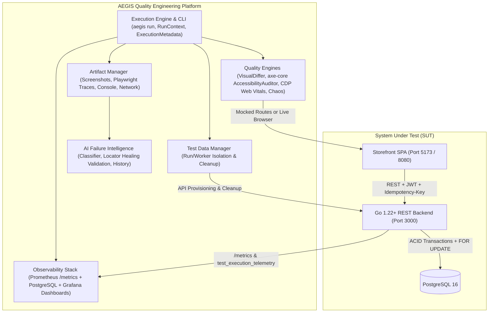
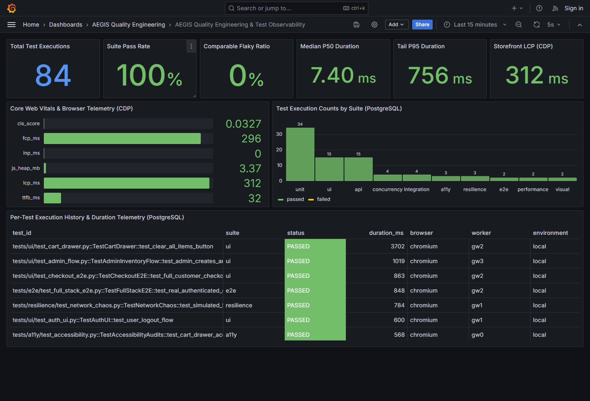
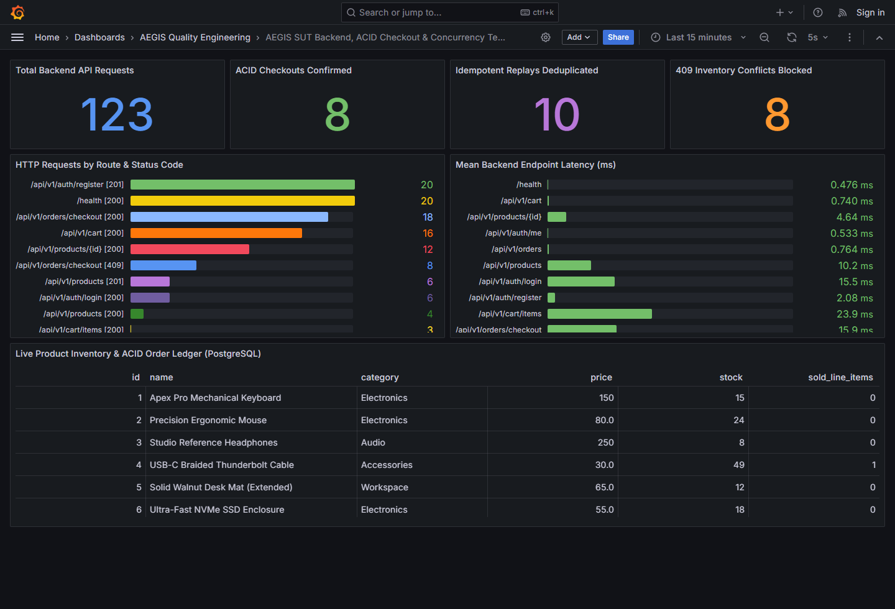
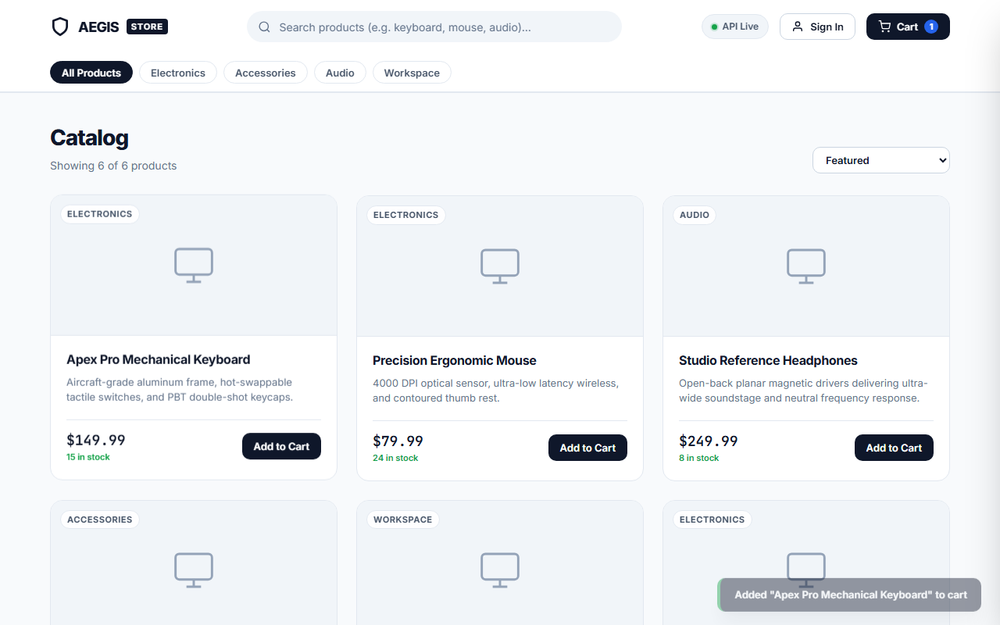
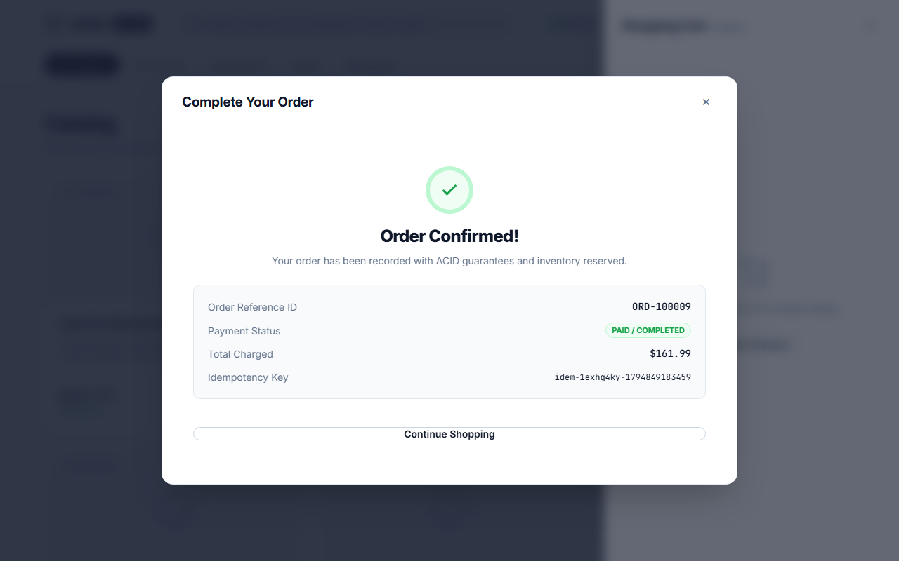
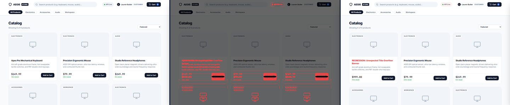

# AEGIS — Quality Engineering & Test Infrastructure Platform

[](https://python.org)
[](https://go.dev)
[](https://playwright.dev/python/)
[](https://pytest.org)
[](https://www.postgresql.org)
[](https://www.docker.com)

**AEGIS** is a modular Quality Engineering & Test Infrastructure platform built with **Python 3.12+**, **Playwright**, **Pytest**, **Pydantic v2**, and **Allure**, paired with a reproducible full-stack **System Under Test (SUT)** consisting of a Storefront SPA, a **Go 1.22+ REST API**, and **PostgreSQL 16**.

---

## Architecture: AEGIS Framework vs. System Under Test (SUT)

AEGIS strictly decouples reusable test infrastructure (`framework/`, `tests/`) from the application under validation (`frontend/`, `backend/`, PostgreSQL):



### Core Capabilities

- **Execution Engine & CLI (`framework/execution/`)**: `aegis run` (with `--suite`, `--workers`, `--browser`, `--environment`, `--base-url`, `--api-url`, and side-effect-free `--dry-run`) and `aegis reliability` commands built on top of `pytest` / `pytest-xdist`, assigning a shared `AEGIS_RUN_ID` across controller and workers and persisting `reports/runs/<run_id>/metadata.json`.
- **Artifact Manager (`framework/artifacts/`)**: Per-run isolated output (`screenshots/`, `traces/`, `videos/`, `network/`, `logs/`, `ai_diagnostics/`, `allure-results/`), genuine `context.tracing.start/stop` trace ZIPs captured on failure, post-close video persistence when `CAPTURE_VIDEO_ON_FAILURE=true`, browser console logs, failed HTTP 4xx/5xx network logs, and configurable old-run retention cleanup.
- **Test Data Management (`framework/data/manager.py`)**: `TestDataManager` provisions isolated users, products, carts, and orders scoped by `run_id` and `PYTEST_XDIST_WORKER`, cleaning up all tracked entities during teardown even after test failures.
- **Quality Analysis Engines (`framework/quality/`, `framework/telemetry/`)**:
  - `VisualDiffer`: Strict pixel comparison failing on missing baselines or dimension mismatches (no silent baseline creation or resizing), producing highlighted red diff masks and 3-panel side-by-side composites (`baseline | diff | actual`) plus desktop/tablet/mobile viewport profiles.
  - `AccessibilityAuditor`: Automated accessibility testing powered by the bundled `axe-core` engine (`framework/quality/vendor/axe.min.js`) plus AEGIS structural rules (rejecting `placeholder` as a valid label), modal ARIA dialog verification, and keyboard `Tab` focus traversal checks.
  - `CDPTelemetryCollector` & `PerformanceThresholdEvaluator`: Detaches CDP sessions safely in `finally`, raises typed `TelemetryCollectionError` on errors, captures TTFB, FCP, LCP, windowed session CLS, interaction-filtered INP, JS heap MB, DOM counts, and API resource latency, and exports telemetry to `/api/v1/telemetry/ingest` for Prometheus scraping when enabled.
- **Grafana & Prometheus Observability (`monitoring/`, `backend/main.go`)**: Go backend exposes Prometheus metrics at `/metrics` and ingests per-test execution and Web Vitals telemetry into PostgreSQL (`test_execution_telemetry`) via `POST /api/v1/telemetry/ingest`. Grafana (`http://localhost:3001`) auto-provisions Prometheus + PostgreSQL datasources and two live dashboards (**Quality Engineering & Test Observability** and **SUT Backend, ACID Checkout & Concurrency Telemetry**).
- **Reliability Analyzer (`framework/telemetry/reliability.py`)**: Records execution outcomes in `execution_history.jsonl`, computes pass rate, failure rate, comparable-condition flaky rate (same browser & environment across repeated runs or retries), P50/P95 durations, duration regressions, and forwards telemetry into Grafana/PostgreSQL.
- **AI Failure Intelligence (`framework/ai/`)**: Uses deterministic multi-signal classification (`assertion_failure`, `application_error`, `infrastructure_failure`, `locator_failure`, `network_failure`, `timeout_failure`), redacted failure history (`failure_history.jsonl`), DOM candidate locator suggestions (`match_count == 1` + live visibility/enabled probe on rendered pages), and an audit trail (`pending_human_approval` / `rejected`) without ever altering failed test status.

### Test Suites & Pytest Markers

| Suite | Marker | Backend Required | Purpose |
| :--- | :--- | :--- | :--- |
| **Unit & Contracts** | `-m unit` | No | Framework unit tests, artifact/visual/a11y/telemetry/reliability/AI unit tests, Pydantic DTO checks |
| **Mocked UI** | `-m ui_mocked` | No | Deterministic UI component flows using Playwright `page.route()` mocks |
| **Backend Integration** | `-m integration` | Yes | Live HTTP integration against Go API + PostgreSQL (auth, cart CRUD, RBAC, `Idempotency-Key`) |
| **Concurrency & ACID** | `-m concurrency` | Yes | Concurrent idempotency storm, limited-stock race conditions, multi-item transaction rollback |
| **Full-Stack E2E** | `-m e2e` | Yes | Real API-authenticated Playwright browser sessions backed by Go API + PostgreSQL |
| **Quality & Chaos** | `-m "resilience or performance or visual or a11y"` | No | Network fault injection, CDP Web Vitals, pixel visual regression, automated accessibility testing |

---

## Platform Visual Walkthrough & Observability

### 1. Grafana Quality Engineering & Test Observability Dashboard
Provisioned automatically via `docker compose` (`http://localhost:3001`), backed by **Prometheus** (`/metrics`) and **PostgreSQL 16** (`test_execution_telemetry`). Tracks suite pass rate, comparable flaky ratio, P50/P95 durations, Core Web Vitals (`LCP`, `FCP`, `TTFB`, `CLS`, `JS Heap`), suite execution breakdowns, and per-test telemetry history.



### 2. Grafana SUT Backend, ACID Checkout & Concurrency Telemetry
Real-time Go backend instrumentation monitoring HTTP request throughput, endpoint latency, ACID checkout confirmations, `Idempotency-Key` duplicate replays prevented, `409 Conflict` inventory race-condition blocks, and live PostgreSQL stock levels.



### 3. Live System Under Test & ACID Checkout Verification
The Storefront SPA connects directly to the Go 1.22+ REST API and PostgreSQL 16 (`API Live` indicator), verifying cart operations, real-time stock synchronization, and transactional order confirmation with `Idempotency-Key` deduplication.





### 4. Pixel-Level Visual Regression Engine
`VisualDiffer` enforces strict baseline existence and exact dimension matching (no silent resizing or auto-creation) and outputs highlighted red difference masks alongside 3-panel side-by-side composites (`Baseline | Diff Mask | Actual`).



---

## Repository Structure

```text
├── backend/                          # SUT: Go 1.22+ REST API, Prometheus /metrics & PostgreSQL schema/seed
│   ├── main.go
│   ├── go.mod / go.sum
│   └── Dockerfile
├── frontend/                         # SUT: Storefront Single Page Application
├── monitoring/                       # Grafana & Prometheus provisioning + JSON dashboards
│   ├── prometheus/prometheus.yml
│   └── grafana/
│       ├── provisioning/             # Auto-provisioned Prometheus + PostgreSQL datasources & folders
│       └── dashboards/               # Quality Observability & SUT ACID Telemetry dashboards
├── framework/                        # AEGIS Reusable Test Infrastructure
│   ├── ai/                           # Failure classifier, locator healer + validator, history
│   ├── api/                          # Typed HTTP client & Pydantic v2 DTO schemas
│   ├── artifacts/                    # ArtifactManager, console & network failure collectors
│   ├── config/                       # Pydantic Settings configuration
│   ├── data/                         # TestDataManager (isolated provisioning & cleanup)
│   ├── execution/                    # RunContext, ExecutionMetadata, aegis CLI
│   ├── pages/                        # Component Object Model (COM) pages & components
│   ├── quality/                      # VisualDiffer, AccessibilityAuditor, ChaosNetworkInjector
│   ├── telemetry/                    # CDPTelemetryCollector, browser snapshot, ReliabilityAnalyzer
│   └── utils/                        # DataFactory & backwards-compatible exports
├── tests/
│   ├── conftest.py                   # Modular fixture exports, xdist run propagation & hooks
│   ├── fixtures/                     # server, browser, authentication, api, quality_tools
│   ├── support/                      # mock_routes, test_data, artifact_helpers
│   ├── unit/                         # Framework unit tests
│   ├── api/                          # Contract tests & live API integration tests
│   ├── ui/                           # Mocked UI tests
│   ├── integration/                  # Real Go backend + PostgreSQL integration tests
│   ├── concurrency/                  # Idempotency, race condition & rollback concurrency tests
│   ├── e2e/                          # Full-stack browser + backend + PostgreSQL E2E tests
│   ├── resilience/                   # Network chaos & fault injection tests
│   ├── performance/                  # Web Vitals & CDP telemetry tests
│   ├── visual/                       # Pixel-level visual regression tests
│   └── a11y/                         # Automated DOM, modal & keyboard accessibility checks
├── .github/workflows/ci.yml          # Multi-stage CI/CD pipeline (lint, mypy, matrix unit, mocked UI, live integration/e2e, nightly)
├── docker-compose.yml                # Full-stack orchestration (db, backend, storefront, prometheus, grafana, test-runner)
├── Dockerfile                        # Headless Python 3.12 + Playwright test-runner image
├── Makefile                          # Developer workflow commands
└── pyproject.toml                    # Python 3.12+, strict lockfile deps, scripts, pytest/ruff/mypy config
```

---

## Quickstart

### Option 1: Reproducible Full-Stack Run via Docker Compose (Recommended)

Run the entire stack (`PostgreSQL 16` -> `Go Backend` -> `Storefront` -> `Pytest + Playwright`) with healthcheck-gated startup and automatic container stop on exit:

```bash
docker compose up --build --abort-on-container-exit --exit-code-from test-runner
```

Remove containers, networks, and database volumes afterward:

```bash
docker compose down -v
```

### Option 2: Local Development Setup (`uv` + Python 3.12+)

```bash
# Install locked dependencies + dev tools (ruff, mypy) and Playwright Chromium
uv sync --frozen --extra dev
uv run playwright install --with-deps chromium

# Static analysis, type checking & locked dependency audit
uv run ruff check .
uv run ruff format --check .
uv run mypy framework tests
uv export --frozen --no-hashes --no-emit-project -o /tmp/requirements-audit.txt && uvx pip-audit --progress-spinner off -r /tmp/requirements-audit.txt

# Run backend-independent suites via pytest or AEGIS CLI
uv run aegis run --suite unit --workers 1
uv run pytest -m ui_mocked -n 4 -v

# Start PostgreSQL, Go backend, Storefront, Prometheus (9090), and Grafana (3001)
docker compose up -d --build --wait db backend storefront prometheus grafana
REQUIRE_BACKEND=true uv run pytest -n 4 -v
uv run aegis reliability
docker compose down -v
```

---

## Author
Developed by **Max Bruk**.

## License
MIT
