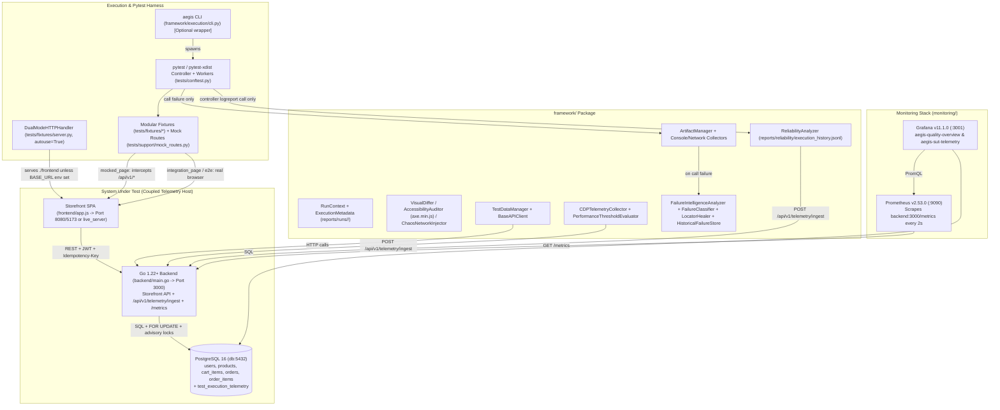
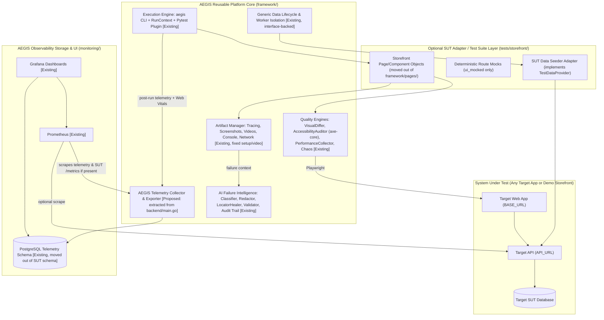

# AEGIS — Comprehensive Engineering Architecture & Quality Audit

**Audit Scope:** Full static code inspection, cross-file execution tracing, architecture review, CI/CD & container verification, security/reliability review, and empirical test suite execution against the live Go + PostgreSQL + Grafana stack.  
**Audit Mode:** Assessment-only (no existing source, test, configuration, or documentation files modified).

---

## 1. Executive Summary

### Overall Engineering Assessment
AEGIS has progressed beyond a basic Playwright + Pytest starter script into a structured automated testing codebase with a real Go 1.22+ / PostgreSQL 16 System Under Test (SUT), a 6-service Docker Compose topology (`db`, `backend`, `storefront`, `prometheus`, `grafana`, `test-runner`), xdist-coordinated run tracking (`RunContext`), artifact preservation (`ArtifactManager`), pixel-level visual comparison (`VisualDiffer`), `axe-core` v4.10.2 integration (`AccessibilityAuditor`), CDP/PerformanceObserver Web Vitals collection (`CDPTelemetryCollector`), and a deterministic failure triage module (`framework/ai/`).

However, when evaluated against the target **Quality Engineering & Test Infrastructure Platform** architecture, AEGIS contains significant architectural coupling, blind spots in failure accounting and quality gates, silent client-side mock fallbacks, and SUT security/isolation gaps that prevent it from functioning as an independent, trustworthy platform today.

### Current Architectural Maturity
**Transitional — Application-Coupled Test Framework with Early Platform Primitives.**  
Although `framework/` is packaged via `hatchling` (`pyproject.toml:34-40`) and exposes an `aegis` CLI (`pyproject.toml:31-32`), AEGIS cannot currently be pointed at an arbitrary external web application without code changes or dead weight from the embedded Storefront SUT. Core observability storage and Prometheus exposition live inside the Go Storefront backend (`backend/main.go`), Storefront-specific Page Objects reside inside `framework/pages/`, and session-wide `autouse` fixtures launch a static `./frontend` server regardless of which suite is run.

### Strongest Existing Capabilities
1. **Backend Concurrency & ACID Transaction Verification (`backend/main.go:948-1188`, `tests/concurrency/test_backend_concurrency.py:25-173`):**  
   The Go checkout handler serializes duplicate `Idempotency-Key` requests with PostgreSQL transaction-scoped advisory locks (`pg_advisory_xact_lock(hashtext($1))`, `backend/main.go:1004`), sorts requested product IDs deterministically to prevent deadlocks (`backend/main.go:1066-1068`), locks inventory rows with `SELECT ... FOR UPDATE` (`backend/main.go:1080`), and rolls back multi-item transactions atomically on partial stock exhaustion. Multi-threaded concurrency tests in `tests/concurrency/test_backend_concurrency.py` assert both HTTP responses and resulting product/order state.
2. **Strict Visual Regression Engine (`framework/quality/visual.py:57-252`, `tests/unit/test_visual_differ.py:17-157`):**  
   `VisualDiffer.compare_images_detailed()` explicitly fails on missing baselines (`baseline_missing`, lines 116–138) unless `UPDATE_VISUAL_BASELINES` / `update_baselines=True` is set, refuses to resize mismatched viewports (`dimension_mismatch`, lines 144–166), and generates red diff overlays alongside 3-panel side-by-side composites (`Baseline | Diff | Actual`, lines 84–96, 202–209).
3. **Xdist-Coordinated RunContext & Genuine Playwright Tracing (`framework/execution/run_context.py:13-89`, `framework/artifacts/manager.py:36-218`, `tests/conftest.py:94-114`):**  
   The pytest controller generates a single `AEGIS_RUN_ID` in `pytest_configure` (`tests/conftest.py:103`), passes it to `pytest-xdist` workers via `pytest_configure_node` / `workerinput` (`tests/conftest.py:98-113`), uses genuine `context.tracing.start/stop` archives (`framework/artifacts/manager.py:56-88`) rather than mislabeled videos, and namespaces failure artifacts by worker ID (`framework/artifacts/manager.py:101-102`).

### Most Serious Weaknesses
1. **Broken Setup-Phase Failure Accounting (`tests/conftest.py:122, 137`):**  
   `pytest_runtest_makereport` only collects artifacts when `report.when == "call"`, and `pytest_runtest_logreport` skips every non-call report except `setup` skips (`report.when == "setup" and report.skipped`). Any fixture `setup` failure (e.g., `REQUIRE_BACKEND=true` failing `backend_health`, or `authenticated_page` failing user registration) captures zero failure artifacts and records zero failed executions in `ReliabilityAnalyzer` / Grafana, allowing dashboards to display a false `100%` pass rate.
2. **Framework <-> SUT Architectural Coupling (`backend/main.go:264-283, 1506-1730`, `framework/pages/`, `tests/fixtures/server.py:15-56`, `Dockerfile:19-21`):**  
   The SUT's Go REST API doubles as AEGIS's telemetry collector (`POST /api/v1/telemetry/ingest`), PostgreSQL observability schema owner (`test_execution_telemetry`), and Prometheus exporter (`GET /metrics`). Meanwhile, `framework/pages/` embeds demo Storefront Page Objects inside the installable `framework` package, and `live_server` (`autouse=True`) binds a single-threaded HTTP server serving `./frontend` on every test session, including pure `unit` and `api` runs.
3. **SUT Security & Cross-Tenant Data Integrity Flaws (`backend/main.go:954-963, 1003-1018, 1190-1237, 1399-1423, 1506`):**  
   `POST /api/v1/orders/checkout` permits unauthenticated requests to submit `req.Items` and deduct PostgreSQL inventory; `loadOrderByIdempotencyKey` queries `orders WHERE idempotency_key = $1` without scoping by `user_id` (returning another user's order details on key collision/guess); `POST /api/v1/telemetry/ingest` accepts unauthenticated writes; and user passwords are hashed with single-round `SHA-256` instead of `bcrypt`/`argon2`.
4. **Frontend Split-Brain State & Silent Mock Fallbacks (`frontend/app.js:562-605, 790-798, 919-935, 996-1012, 1149-1168, 1194-1209`):**  
   Cart quantity adjustments (`updateCartItemQty`), item removals (`removeCartItem`), and cart clearing (`clearCart`) mutate only browser `localStorage` and never call backend `PUT`/`DELETE /api/v1/cart` endpoints. Worse, `handlePlaceOrder`, `handleLogin`, `handleRegister`, `handleAdminCreateProduct`, and `handleAdminDeleteProduct` silently fabricate fake successes on `TypeError` / `Failed to fetch` when `!state.isApiReachable`.
5. **Incomplete Test Data Teardown & Shared Seed Mutation (`framework/data/manager.py:76, 118, 214-241`, `tests/fixtures/authentication.py:90-124`, `tests/e2e/test_full_stack_e2e.py:42`):**  
   `TestDataManager._created_user_emails` is populated on registration and never deleted during `cleanup()`. `authenticated_page` registers users outside `TestDataManager`, leaving orphaned accounts in PostgreSQL. `test_real_authenticated_customer_checkout_e2e` purchases shared seed product `id=4` (`stock=50`), which exhausts seed stock after 50 runs on a persistent volume.

### Biggest Risks
* **False Confidence from Green Gates:** Setup failures are invisible in `ReliabilityAnalyzer` (`tests/conftest.py:137`); `uvx pip-audit || true` (`.github/workflows/ci.yml:53`) ignores vulnerable dependencies; `tests/visual/test_visual_diff.py:44, 81` permits a `7.5%` full-page pixel diff; and `tests/a11y/test_accessibility.py:27, 50, 73` only fails on `severity == "critical"`, ignoring all `"serious"` and `"moderate"` WCAG violations.
* **Classification & Transport Masking:** `BaseAPIClient.request()` (`framework/api/client.py:85-92`) converts `ConnectError` and `TimeoutException` into synthetic HTTP `503` responses, while `FailureClassifier.classify()` (`framework/ai/classifier.py:62-130`) checks broad substrings such as `"locator."` before `"timeout"` or `assertion_markers`.
* **Platform Portability Blockers:** An engineer attempting to adopt AEGIS for another system must currently decouple `framework/` from `frontend/` and extract telemetry ingestion out of `backend/main.go`.

### Readiness for Target Platform Direction
AEGIS is **ready to transition from prototype to a real internal platform only after closing P0/P1 reliability and decoupling gaps** (primarily setup failure accounting, extracting the telemetry collector out of `backend/main.go`, separating SUT Page Objects out of `framework/pages/`, removing `autouse=True` on `live_server`, and tightening visual/a11y/API assertion gates).

---

## 2. Repository and Architecture Overview

### Actual Subsystems on Disk
* **Reusable Framework (`framework/`):**
  * `config/settings.py` — Pydantic `BaseSettings` singleton (`settings`).
  * `execution/` — `RunContext`, `ExecutionMetadata`, `aegis` CLI (`run`, `reliability`).
  * `artifacts/` — `ArtifactManager`, `BrowserConsoleCollector`, `NetworkFailureCollector`.
  * `data/` — `TestDataManager` (`ProvisionedUser`, `ProvisionedProduct`, `ProvisionedOrder`).
  * `api/` — `BaseAPIClient`, typed endpoint wrappers (`AuthAPI`, `ProductsAPI`, `CartAPI`, `OrdersAPI`), and Pydantic v2 DTOs (`framework/api/models/`).
  * `pages/` — `BasePage`, `StorefrontPage`, `AdminPage`, and 6 component objects (`framework/pages/components/`), currently specific to the Storefront SUT.
  * `quality/` — `VisualDiffer`, `AccessibilityAuditor` (with vendored `framework/quality/vendor/axe.min.js`), `ChaosNetworkInjector`.
  * `telemetry/` — `CDPTelemetryCollector`, `PerformanceThresholdEvaluator`, `ReliabilityAnalyzer`, `collect_browser_runtime_snapshot`.
  * `ai/` — `FailureClassifier`, `LocatorHealer`, `LocatorValidationEngine`, `HistoricalFailureStore`, `FailureIntelligenceAnalyzer`.
  * `utils/` — `DataFactory` plus backwards-compatibility re-export shims (`a11y_auditor.py`, `cdp_metrics.py`, `chaos_network.py`, `visual_differ.py`).
* **Test Suite & Harness (`tests/`):**
  * `conftest.py`, `fixtures/` (`api`, `authentication`, `browser`, `quality_tools`, `server`), `support/` (`artifact_helpers`, `mock_routes`, `test_data`).
  * 10 test directories (`unit`, `api`, `ui`, `integration`, `concurrency`, `e2e`, `resilience`, `performance`, `visual`, `a11y`) totaling 84 collected test items.
* **System Under Test (`backend/`, `frontend/`):**
  * `backend/main.go` — Go 1.22+ monolith providing Storefront REST APIs, JWT auth, PostgreSQL schema initialization/seeding, **plus** `/api/v1/telemetry/ingest`, `test_execution_telemetry` table, and Prometheus `/metrics`.
  * `frontend/` — Vanilla HTML/CSS/JS Storefront SPA (`index.html`, `app.js`, `styles.css`).
* **Observability Provisioning (`monitoring/`):**
  * `monitoring/prometheus/prometheus.yml` (2s scrape interval targeting `backend:3000`).
  * `monitoring/grafana/provisioning/` (Prometheus + PostgreSQL datasources) and `monitoring/grafana/dashboards/` (`aegis-quality-overview.json`, `aegis-sut-telemetry.json`).
* **Build, Container & CI Orchestration:**
  * `docker-compose.yml` (6 services), `Dockerfile`, `backend/Dockerfile`, `pyproject.toml`, `uv.lock`, `Makefile`, `.github/workflows/ci.yml`.

### Existing Component & Data-Flow Diagram

---

## 3. Feature and Milestone Assessment (M0–M5)

| ID | Requirement | Status | Evidence | Gap | Priority |
| :--- | :--- | :--- | :--- | :--- | :--- |
| **M0.1** | Complete SUT + runner + observability in Docker Compose | IMPLEMENTED | `docker-compose.yml:1-116`, `backend/Dockerfile:1-20`, `Dockerfile:1-29` | `test-runner` does not wait for `prometheus`/`grafana`, and `--abort-on-container-exit` terminates Grafana/Prometheus immediately upon test exit | P2 |
| **M0.2** | Healthchecks, DB readiness vs container startup, migrations | IMPLEMENTED | `docker-compose.yml:13-39, 87-105`, `backend/main.go:191-338, 354-373` | Migrations are inline `CREATE TABLE IF NOT EXISTS` statements in `migrateAndSeed` with no schema versioning or down migrations | P2 |
| **M0.3** | Strict separation between Mocked UI and Real Integration modes | PARTIALLY IMPLEMENTED | `tests/fixtures/browser.py:83-147`, `tests/fixtures/authentication.py:37-155`, `pyproject.toml:45-59` | Default `page` and `storefront_page` alias `mocked_page`/`mocked_storefront_page`, so `a11y`/`visual`/`performance` run against mocks; `frontend/app.js` silently falls back to local mock behavior when API is unreachable | P1 |
| **M0.4** | Consistent Python >=3.12 and enforced dependency lockfile | IMPLEMENTED | `pyproject.toml:6`, `Dockerfile:2,13,24`, `.github/workflows/ci.yml:27,31-32`, `uv.lock` | `Dockerfile:7` pulls mutable `ghcr.io/astral-sh/uv:latest` rather than a pinned digest/version | P2 |
| **M0.5** | Clean-checkout build & test reproducibility | PARTIALLY IMPLEMENTED | `docker-compose.yml:106-113`, `Dockerfile:18-24` | `Dockerfile` does not copy `reports/artifacts/visual_baselines`, relying on Compose bind-mount `./reports:/app/reports` | P1 |
| **M1.1** | Modular `conftest.py` and fixture separation of concerns | PARTIALLY IMPLEMENTED | `tests/conftest.py:1-201`, `tests/fixtures/{api,authentication,browser,quality_tools,server}.py` | `live_server` (`tests/fixtures/server.py:36`) is `autouse=True` session-wide (starts for `unit`/`api` tests), ignores `settings.BASE_URL` from `.env` (line 39), and uses non-threaded `TCPServer` (line 32) | P1 |
| **M1.2** | Centralized `ArtifactManager` (screenshots, console, network, video, retention) | PARTIALLY IMPLEMENTED | `framework/artifacts/manager.py:36-218`, `framework/artifacts/collectors.py:14-127`, `tests/support/artifact_helpers.py:53-116` | `save_video_on_failure` (`framework/artifacts/manager.py:156-177`) is never called (`CollectedArtifacts.video_path` is always `None`); `setup` failures collect no artifacts (`tests/conftest.py:122`); `pyproject.toml:44` writes global `reports/report.html` & `reports/allure-results` | P1 |
| **M1.3** | Real Playwright tracing via `context.tracing` | IMPLEMENTED | `framework/artifacts/manager.py:56-89`, `tests/fixtures/browser.py:75-79` | Active trace tracking uses `set[int]` on `id(context)` rather than weak references; safe in practice while `context` is alive | P3 |
| **M1.4** | Resource cleanup & parallel worker isolation (`pytest-xdist`) | PARTIALLY IMPLEMENTED | `tests/conftest.py:94-114`, `tests/fixtures/api.py:39-46`, `tests/support/test_data.py:7-24` | `FailureIntelligenceAnalyzer.save_report` (`framework/ai/analyzer.py:149-151`) omits `worker_id` in output filename; JSONL appends lack file locking | P2 |
| **M1.5** | Framework component unit tests (`tests/unit/`) | PARTIALLY IMPLEMENTED | `tests/unit/test_*.py` (9 modules, 34 unit-level functions + 13 API contract tests) | `tests/unit/test_accessibility_auditor.py:15-111` is marked `@pytest.mark.unit` but requires launching a real Playwright Chromium `browser` fixture | P2 |
| **M2.1** | Visual Regression (`VisualDiffer`, strict baseline/dimensions, diffs, viewports) | PARTIALLY IMPLEMENTED | `framework/quality/visual.py:14-252`, `tests/visual/test_visual_diff.py:15-91` | Engine is strict, but `tests/visual/test_visual_diff.py:44,81` sets a `7.5%` mismatch threshold, writes into shared `reports/artifacts/`, does not pass `animations="disabled"`, and `set_viewport_size()` drops `device_scale_factor=2.0` on mobile | P1 |
| **M2.2** | Accessibility (`axe-core`, accessible names, keyboard checks, honest scope) | PARTIALLY IMPLEMENTED | `framework/quality/accessibility.py:10-344`, vendored `axe.min.js`, `tests/a11y/test_accessibility.py:13-79` | `tests/a11y/test_accessibility.py:27,50,73` only fails on `severity == "critical"` (ignoring `"serious"` and `"moderate"` violations from `axe-core`); `_run_axe_if_available` extracts only `nodes[0]` (`line 266`); `check_keyboard_navigation` (`line 340`) passes when `visited_count == 1` | P1 |
| **M2.3** | Performance Telemetry (TTFB, FCP, LCP, CLS, INP, DOM, Heap, API latency, SLA separation) | PARTIALLY IMPLEMENTED | `framework/telemetry/performance.py:22-263`, `tests/performance/test_web_vitals.py:17-68` | `INP` computation (`lines 164-170`) does not filter `interactionId > 0` and is always `0` in `test_web_vitals.py` because no interaction occurs; `capture_web_vitals()` pushes HTTP telemetry unconditionally (`line 240`); `collect_browser_runtime_snapshot` (`framework/telemetry/browser.py:11`) is dead code | P2 |
| **M2.4** | Backend API quality, `TestDataManager`, DB state & concurrency verification | PARTIALLY IMPLEMENTED | `framework/api/client.py:33-119`, `framework/data/manager.py:61-241`, `tests/integration/test_backend_integration.py`, `tests/concurrency/test_backend_concurrency.py` | `BaseAPIClient` converts transport/timeout errors into synthetic HTTP `503` (`line 87`); `tests/api/test_*` contracts only validate static Python dicts; `TestDataManager.cleanup()` never deletes created users/orders; `tests/e2e/test_full_stack_e2e.py:42` mutates shared seed product `id=4` | P1 |
| **M3.1** | Split PR vs Nightly CI pipelines | PARTIALLY IMPLEMENTED | `.github/workflows/ci.yml:1-260` | `schedule` (`line 9`) triggers PR jobs (`unit-tests`, `ui-mocked`, `integration-and-e2e`) alongside `nightly-full-regression`; `visual` and `performance` never run on PRs | P2 |
| **M3.2** | Live Go + PostgreSQL integration job in CI | IMPLEMENTED | `.github/workflows/ci.yml:134-218` | Go backend runs under `nohup` (`line 169`), but `/tmp/backend.log` is only dumped if `/health` times out, not uploaded on test failures | P2 |
| **M3.3** | Static analysis (`ruff`, `mypy`, `go vet`) & dependency scanning | PARTIALLY IMPLEMENTED | `.github/workflows/ci.yml:34-53`, `pyproject.toml:67-81` | `uvx pip-audit --progress-spinner off || true` (`.github/workflows/ci.yml:53`) masks security vulnerabilities instead of gating or reporting deterministically | P1 |
| **M3.4** | Preserve failure & diagnostic artifacts (`if: always()`) | IMPLEMENTED | `.github/workflows/ci.yml:85, 122, 207, 250` | Multiple pytest invocations in a single job would overwrite `reports/report.html` and `reports/allure-results/` if not overridden | P2 |
| **M4.1** | `RunContext`, `AEGIS_RUN_ID`, and `ExecutionMetadata` | PARTIALLY IMPLEMENTED | `framework/execution/run_context.py:13-89`, `framework/execution/metadata.py:11-37`, `tests/conftest.py:94-201` | `pytest_configure` creates `reports/runs/<run_id>/` and deletes old runs even during `--collect-only` or `--help` (`tests/conftest.py:105`) | P2 |
| **M4.2** | CLI execution orchestrator (`aegis run`, `aegis reliability`) | IMPLEMENTED | `framework/execution/cli.py:1-184`, `pyproject.toml:31-32` | `Makefile`, `Dockerfile`, `docker-compose.yml`, and `.github/workflows/ci.yml` bypass `aegis run` and invoke `uv run pytest` directly | P2 |
| **M4.3** | `ReliabilityAnalyzer` & comparable flaky/percentile analytics | PARTIALLY IMPLEMENTED | `framework/telemetry/reliability.py:21-424`, `tests/conftest.py:134-160` | `pytest_runtest_logreport` (`tests/conftest.py:137`) ignores `setup`/`teardown` failures; `retry_count` (`reliability.py:34`) is never populated by hooks; `execution_history.jsonl` grows without bound | P1 |
| **M4.4** | Prometheus + PostgreSQL + Grafana observability | PARTIALLY IMPLEMENTED | `monitoring/**`, `backend/main.go:28-53, 264-283, 1482-1730` | Ingestion is coupled inside the Go Storefront SUT; Prometheus test/Web Vitals metrics are mutable scalar gauges overwritten on every push rather than labeled time-series metrics; `handleMetrics` returns all historical totals unreset per run | P1 |
| **M5.1** | Deterministic Failure Classifier before LLM usage | PARTIALLY IMPLEMENTED | `framework/ai/classifier.py:11-137` | Classifier checks any captured `>=500` network entry (`line 62`) and broad substring `"locator."` (`line 90`) before `timeout` (`line 109`) and `assertion_markers` (`line 117`), causing misclassifications | P1 |
| **M5.2** | Failure context extraction (stack, console, network, DOM, artifacts) | IMPLEMENTED | `tests/support/artifact_helpers.py:53-116`, `framework/ai/analyzer.py:76-154` | Triggered only on `report.when == "call"` (`tests/conftest.py:122`), missing fixture setup errors | P1 |
| **M5.3** | Locator healing candidates & validation engine | PARTIALLY IMPLEMENTED | `framework/ai/locator_healer.py:58-275` | `_InteractiveDOMParser.handle_endtag` (`lines 87-89`) fails to pop void `<input>` tags; `validate_against_html` (`lines 209, 215, 218`) naively splits selectors on `"` | P2 |
| **M5.4** | Structured outputs, non-masking test status & human-approval audit trail | IMPLEMENTED | `framework/ai/analyzer.py:26-38, 110-123`, `framework/ai/locator_healer.py:44-56` | Always sets `test_status="failed"` and `approval_status="pending_human_approval"` / `"rejected"` | — |
| **M5.5** | Historical failure similarity & sensitive data protection | PARTIALLY IMPLEMENTED | `framework/ai/history.py:14-122`, `framework/ai/analyzer.py:125-131` | `record_failure` writes raw `error_message[:1000]` without secret/token/header redaction, and `failure_history.jsonl` has no retention cap or xdist lock | P2 |

---

## 4. Detailed Technical Findings

### AEGIS-001 — Setup-Phase Failures Bypass Artifact Collection and Reliability Accounting
* **Severity:** HIGH  
* **Implementation Status:** BROKEN  
* **Confidence:** HIGH  
* **Affected Component:** Pytest lifecycle hooks / ArtifactManager / ReliabilityAnalyzer  
* **File Path & Line References:** `tests/conftest.py:116-160`  
* **Description:**  
  `pytest_runtest_makereport` checks `if report.when == "call":` (`tests/conftest.py:122`) before invoking `collect_test_failure_artifacts()`. Similarly, `pytest_runtest_logreport` executes `if report.when != "call" and not (report.when == "setup" and report.skipped): return` (`tests/conftest.py:137`).
* **Why It Matters:**  
  Every integration, E2E, concurrency, or UI failure originating inside a fixture (`backend_health`, `authenticated_page`, `admin_page`, `test_data_manager`, `mocked_storefront_page`) fails during `setup` (before `call` runs) with outcome `failed`/`error`. AEGIS collects zero screenshots/traces/AI diagnostics for those failures, omits them from `execution_history.jsonl` and PostgreSQL `test_execution_telemetry`, and allows `ReliabilityAnalyzer` and Grafana to display a `100.0%` pass rate even when fixtures failed.
* **Verification Method:**  
  Observed directly in `tests/conftest.py:122` and `tests/conftest.py:137`. Any fixture raising an assertion or runtime error during setup emits `report.when == "setup"` and `report.failed == True`, hitting the early `return` on line 137.
* **Recommended Solution:**  
  Handle `(report.when == "call") or (report.failed and report.when in ("setup", "teardown"))` in both `pytest_runtest_makereport` and `pytest_runtest_logreport`, deduplicating per `(run_id, nodeid)` in `logreport` if both setup/call/teardown emit events.
* **Acceptance Criteria:**  
  1. A unit/integration test whose fixture raises in `setup` produces `ai_*.json` and browser artifacts (if a page exists) under `reports/runs/<run_id>/`.
  2. `ReliabilityAnalyzer` records `"status": "error"` / `"failed"` for setup failures and drops suite `overall_pass_rate` accordingly.

---

### AEGIS-002 — Go SUT Checkout Allows Unauthenticated Stock Depletion and Cross-User Order Leakage (IDOR)
* **Severity:** HIGH  
* **Implementation Status:** BROKEN  
* **Confidence:** HIGH  
* **Affected Component:** SUT Go Backend Order & Telemetry Endpoints  
* **File Path & Line References:** `backend/main.go:948-1037, 1190-1237, 1506-1611`  
* **Description:**  
  1. **Unauthenticated Checkout / Inventory Drain:** `handleCheckout` only authenticates the request `if authHeader := r.Header.Get("Authorization"); authHeader != ""` (`backend/main.go:955`), leaving `userID == nil` when omitted. If `req.Items` is supplied (`line 1026`), any anonymous caller can decrement PostgreSQL `products.stock` (`lines 1102-1109`) and insert rows into `orders`.
  2. **Cross-Tenant Idempotency Key Replay (IDOR):** Inside `handleCheckout`, `loadOrderByIdempotencyKey(r.Context(), tx, idemKey)` (`lines 1008, 1190-1201`) queries `SELECT ... FROM orders WHERE idempotency_key = $1` without filtering by `user_id`. Anyone supplying an existing `Idempotency-Key` receives the prior customer's `OrderResponse` (including items and totals).
  3. **Unauthenticated Telemetry Ingestion:** `POST /api/v1/telemetry/ingest` (`lines 165, 1506`) requires no authentication, letting any caller overwrite global in-memory Prometheus gauges and insert rows into `test_execution_telemetry`.
* **Why It Matters:**  
  Unauthenticated inventory mutations and cross-tenant order disclosure are classical authorization/IDOR vulnerabilities in the SUT, and unauthenticated telemetry ingest breaks metric integrity.
* **Verification Method:**  
  Direct code inspection of `backend/main.go:954-1037` and `1190-1237`. Also note `loadOrderByIdempotencyKey` scans `userID` from the row without checking against `*userID`.
* **Recommended Solution:**  
  Require valid JWT authentication on `/api/v1/orders/checkout` (or enforce explicit guest-order isolation without leaking authenticated orders), scope `orders.idempotency_key` lookups/uniqueness to `(user_id, idempotency_key)` (returning `409 Conflict` or `403` on mismatched payload/tenant), and protect telemetry ingestion endpoints behind a separate collector/token.
* **Acceptance Criteria:**  
  1. Unauthenticated `POST /api/v1/orders/checkout` returns `401 Unauthorized` (unless an explicit hardened guest token flow is desired).
  2. Reusing User A's `Idempotency-Key` as User B never returns User A's order.
  3. New integration tests verify both negative cases.

---

### AEGIS-003 — Tight Architectural Coupling Between Reusable AEGIS Platform and Storefront SUT
* **Severity:** HIGH  
* **Implementation Status:** PARTIALLY IMPLEMENTED  
* **Confidence:** HIGH  
* **Affected Component:** Framework packaging, SUT backend telemetry host, fixture server, Page Objects  
* **File Path & Line References:** `backend/main.go:28-53, 164-165, 264-283, 1482-1730`, `tests/fixtures/server.py:15-56`, `framework/pages/`, `Dockerfile:19-21`, `pyproject.toml:38-40`  
* **Description:**  
  Four coupling points bind the platform to the demo e-commerce application:
  1. Test execution telemetry (`POST /api/v1/telemetry/ingest`), PostgreSQL table `test_execution_telemetry`, and Prometheus `aegis_test_*` / `aegis_web_vitals_gauge` metrics are hosted inside the Storefront e-commerce binary (`backend/main.go`). Adopting AEGIS for another app means losing Grafana test observability unless that app reimplements AEGIS's ingest API.
  2. Demo-specific Storefront Page Objects (`StorefrontPage`, `AdminPage`, `AuthModalComponent`, etc.) reside inside `framework/pages/` (`pyproject.toml:39` packages `framework`), rather than in a test-suite/SUT adapter layer.
  3. `live_server` (`tests/fixtures/server.py:36`) is `autouse=True` at `session` scope and hardcodes `Path(__file__).resolve().parents[2] / "frontend"` (`line 19`), starting an HTTP server even during `pytest -m unit` or `pytest -m api`. Furthermore, `live_server` checks `os.environ.get("BASE_URL")` (`line 39`) directly rather than `settings.BASE_URL`, ignoring `.env` files!
  4. `tests/fixtures/browser.py:117` and `tests/fixtures/authentication.py:115, 147` inject `window.AEGIS_API_URL` tightly coupled to `frontend/app.js:18`.
* **Why It Matters:**  
  Violates the stated primary goal: a developer cannot plug AEGIS into an external product without modifying core framework code and fixtures.
* **Verification Method:**  
  Trace imports from `framework/pages/__init__.py`, `tests/fixtures/server.py:18-45`, and `framework/telemetry/reliability.py:253` -> `backend/main.go:1506`.
* **Recommended Solution:**  
  Extract Storefront Page Objects out of `framework/pages/` into a `sut_storefront/` or `tests/pages/` package, keep generic `BasePage` / DOM helpers in `framework/`, make `live_server` opt-in (non-`autouse`, only depended upon by browser fixtures when `BASE_URL` is unset, honoring `settings.BASE_URL` and using `ThreadingTCPServer`), and extract AEGIS's telemetry collector (ingest API + Prometheus exporter) into a standalone AEGIS observability sidecar/module independent of the SUT.
* **Acceptance Criteria:**  
  1. `uv run pytest -m unit` executes without starting any HTTP server or referencing `frontend/`.
  2. Pointing `BASE_URL` in `.env` to an external URL overrides `live_server` and runs UI/visual/a11y/perf checks cleanly against any app without the Go Storefront backend.

---

### AEGIS-004 — Incomplete `TestDataManager` Teardown and Shared Seed Mutation in E2E Tests
* **Severity:** HIGH  
* **Implementation Status:** BROKEN  
* **Confidence:** HIGH  
* **Affected Component:** Test Data Management & Full-Stack E2E Tests  
* **File Path & Line References:** `framework/data/manager.py:74-77, 118, 214-241`, `tests/fixtures/authentication.py:90-124`, `tests/e2e/test_full_stack_e2e.py:42-65`, `tests/integration/test_backend_integration.py:30-58`  
* **Description:**  
  1. `TestDataManager` appends registered emails to `self._created_user_emails` (`framework/data/manager.py:76, 118`), yet `cleanup()` (`lines 214-241`) only clears carts and deletes `_created_product_ids`. Created customer users and checkout `orders` are never deleted (the backend has no admin cleanup/user-delete endpoint either).
  2. `authenticated_page` (`tests/fixtures/authentication.py:100-113`) registers a new user directly via `auth_api` without using `TestDataManager`, leaving orphaned users in PostgreSQL on every E2E run.
  3. `test_real_authenticated_customer_checkout_e2e` (`tests/e2e/test_full_stack_e2e.py:42`) purchases shared seed product `id=4` (`stock=50` seeded at `backend/main.go:320`), decrementing its stock persistently without restocking. Meanwhile `test_cart_crud_lifecycle` (`tests/integration/test_backend_integration.py:47`) uses shared seed product `id=1`.
  4. Unused `TestDataManager.create_isolated_order` (`framework/data/manager.py:182`) exists but is unreferenced anywhere.
* **Why It Matters:**  
  Against a persistent PostgreSQL volume (`postgres_data` in `docker-compose.yml:116`), repeated E2E runs will permanently deplete seed product `id=4` stock to `0`, causing deterministic HTTP 409/disabled-button failures on run 51+, while unbounded `users` and `orders` rows accumulate indefinitely.
* **Verification Method:**  
  Inspected `framework/data/manager.py:76, 118, 214-241` and `tests/e2e/test_full_stack_e2e.py:42-56`.
* **Recommended Solution:**  
  Have E2E checkout tests provision an isolated product via `test_data_manager.create_isolated_product()` (using its returned `product_id` instead of hardcoded `id=4`), track registered users via `TestDataManager`, and implement controlled teardown/cleanup (or mark test-created orders/users and provide an admin test-cleanup endpoint or DB helper disabled outside test environments).
* **Acceptance Criteria:**  
  Running `REQUIRE_BACKEND=true uv run pytest -m e2e` 60 consecutive times against a persistent PostgreSQL database leaves seed product stocks unchanged and passes every iteration.

---

### AEGIS-005 — Storefront SPA Has Split-Brain Cart Sync and Silent Client-Side Mock Fallbacks
* **Severity:** HIGH  
* **Implementation Status:** BROKEN  
* **Confidence:** HIGH  
* **Affected Component:** SUT Storefront SPA (`frontend/app.js`)  
* **File Path & Line References:** `frontend/app.js:562-605, 790-798, 919-935, 996-1012, 1149-1168, 1194-1209`  
* **Description:**  
  1. `addToCart()` (`frontend/app.js:563-572`) posts to `/api/v1/cart/items` asynchronously and swallows errors (`.catch(() => {})`), while `updateCartItemQty()` (`lines 575-592`), `removeCartItem()` (`lines 594-598`), and `clearCart()` (`lines 600-605`) never call backend `PUT /api/v1/cart/items/{id}` or `DELETE /api/v1/cart` at all. Moreover, `handlePlaceOrder()` sends `items: state.cart...` directly in the POST body (`line 763`), bypassing server-side cart state completely.
  2. When `!state.isApiReachable` and a connection error occurs, `handlePlaceOrder()` (`lines 791-797`), `handleLogin()` (`lines 920-935`), `handleRegister()` (`lines 997-1012`), `handleAdminCreateProduct()` (`lines 1150-1168`), and `handleAdminDeleteProduct()` (`lines 1195-1209`) silently fabricate fake tokens, order IDs, and catalog entries in `localStorage`.
  3. Notice also a minor state bug: `handleRegister()` reads `data.id || data.user?.id` (`line 977`) and `data.username || data.name` (`line 978`), whereas the Go backend returns `{"token": ..., "user": {"id": ..., "name": ..., "role": ...}}` (`backend/main.go:434`), causing `state.user.name` and `state.user.role` to fall back to client defaults rather than the DTO.
* **Why It Matters:**  
  In integration/E2E testing, silent client-side mock fallbacks can mask a crashed or disconnected backend during a test (turning a network outage into a passing UI assertion using `localStorage`), and backend cart mutation endpoints (`PUT`/`DELETE /api/v1/cart`) are never exercised through the UI.
* **Verification Method:**  
  Inspect `frontend/app.js:575-605, 790-797, 920-935, 976-982` against `backend/main.go:434, 745-903`.
* **Recommended Solution:**  
  Sync `updateCartItemQty`, `removeCartItem`, and `clearCart` with the backend when authenticated + live; require an explicit opt-in flag (e.g., `?mock=1` or `window.AEGIS_ALLOW_CLIENT_MOCK`) for offline demo mode instead of silently fabricating transactions on connection failures; align `handleRegister` parsing with `data.user`.
* **Acceptance Criteria:**  
  When `Mock Mode` is disabled, backend connection failures surface an explicit error banner in checkout/auth/admin flows instead of succeeding from `localStorage`.

---

### AEGIS-006 — `BaseAPIClient` Masks Transport/Timeout Failures as Synthetic 503s & API Contract Tests Validate Static Dicts
* **Severity:** MEDIUM  
* **Implementation Status:** PARTIALLY IMPLEMENTED  
* **Confidence:** HIGH  
* **Affected Component:** API Client & Contract Test Suite  
* **File Path & Line References:** `framework/api/client.py:39-43, 85-92`, `tests/api/test_auth_api.py:28-92`, `tests/api/test_cart_api.py:26-82`, `tests/api/test_orders_api.py:23-67`, `tests/api/test_products_api.py:27-106`  
* **Description:**  
  1. `BaseAPIClient.request()` catches `(httpx.ConnectError, httpx.TimeoutException, httpx.HTTPError)` (`framework/api/client.py:85-92`) and constructs a synthetic `httpx.Response(status_code=503, ...)`. Callers cannot distinguish a real backend HTTP `503 Service Unavailable` response from a local DNS failure, refused TCP socket, TLS error, or 2-second client timeout (`timeout=2.0`, line 41).
  2. The 13 tests in `TestAuthAPIContract`, `TestCartAPIContract`, `TestOrdersAPIContract`, and `TestProductAPIContract` validate hardcoded Python dictionaries inside the test files rather than validating actual live responses or OpenAPI/JSON schemas emitted by `backend/main.go`.
* **Why It Matters:**  
  Fabricated `503` responses obscure root causes in API tests and failure intelligence (`FailureClassifier` sees HTTP 503 vs `ConnectError`/`Timeout`), and contract tests give false confidence about API schema parity (notice `ProductListResponse` at `product_models.py:51` uses `extra="ignore"` so Go backend returning both `"products"` and `"data"` at `backend/main.go:580-586` is silently accepted).
* **Verification Method:**  
  Read `framework/api/client.py:85-92` and `tests/api/test_*.py`.
* **Recommended Solution:**  
  Raise typed exceptions (`APIConnectionError`, `APITimeoutError`) or introduce explicit `raise_on_transport_error=True` on `BaseAPIClient.request()` (updating `backend_health` fixture to catch transport errors explicitly), and validate real HTTP responses in integration contract tests against Pydantic response DTOs (`AuthResponse`, `CartResponse`, `OrderResponse`, `ProductListResponse`).
* **Acceptance Criteria:**  
  1. `ConnectError` / `TimeoutException` raise typed framework exceptions rather than returning synthetic `status_code=503`.
  2. Live API tests validate `AuthResponse.model_validate(...)`, `CartResponse.model_validate(...)`, `OrderResponse.model_validate(...)`, and `ProductListResponse.model_validate(...)` against Go backend responses.

---

### AEGIS-007 — `FailureClassifier` Rule Ordering Causes Systematic Misclassification
* **Severity:** MEDIUM  
* **Implementation Status:** PARTIALLY IMPLEMENTED  
* **Confidence:** HIGH  
* **Affected Component:** AI Failure Classifier  
* **File Path & Line References:** `framework/ai/classifier.py:62-130`, `tests/support/artifact_helpers.py:92-105`  
* **Description:**  
  `FailureClassifier.classify()` evaluates conditions in a strict short-circuit order that mislabels common Playwright failures:
  1. If `failed_network_requests` contains *any* HTTP `>= 500` response from anywhere in the test lifecycle (`lines 62-74`), the failure is classified as `NETWORK_FAILURE` even if the actual failure was an assertion or locator bug occurring later.
  2. Next, `locator_markers` includes `"locator."` (`line 90`) and `"waiting for locator("` (`line 86`) and checks them *before* `timeout` (`line 109`) and `assertion_markers` (`line 117`). Standard Playwright errors such as `AssertionError: Locator expected to have text ...` (which contains both `"locator"` or `"assertionerror"` / `"expected"` / `"waiting for locator("` from `expect(locator)`) can trigger `LOCATOR_FAILURE` instead of `ASSERTION_FAILURE` or `TIMEOUT_FAILURE`, which then triggers inappropriate locator-healing DOM scans in `FailureIntelligenceAnalyzer` (`framework/ai/analyzer.py:96`).
* **Why It Matters:**  
  Misclassified failures corrupt Grafana `aegis_failures_by_category_total`, skew `ReliabilityAnalyzer.failure_categories`, and generate noisy/wrong remediation advice and spurious locator healing attempts.
* **Verification Method:**  
  Inspect `framework/ai/classifier.py:62-130`. Pass Playwright's typical `expect(locator).to_have_text("foo")` timeout traceback (which contains `AssertionError`, `Locator.to_have_text`, or `waiting for locator(...)`) into `FailureClassifier.classify()`.
* **Recommended Solution:**  
  Order classification by root signal specificity: parse exception type from traceback first (`TimeoutError`, `AssertionError`, Playwright `Error`), remove overly broad substring `"locator."`, distinguish `expect(...)` assertion timeouts (expected text/state mismatch where locator *was* found) from selector-not-found (`resolved to 0 elements` / `strict mode violation`), and treat background `failed_network_requests` as evidence unless a failed network URL/timing correlates with the error or no higher-specificity traceback exception exists.
* **Acceptance Criteria:**  
  Unit tests cover `expect(locator).to_have_text(...)` -> `ASSERTION_FAILURE`, slow navigation timeout -> `TIMEOUT_FAILURE`, missing selector -> `LOCATOR_FAILURE`, and unrelated prior 5xx during a pure assertion failure.

---

### AEGIS-008 — Visual Regression Suite Configuration Permits Large Regressions and Skips DPR Scaling
* **Severity:** MEDIUM  
* **Implementation Status:** PARTIALLY IMPLEMENTED  
* **Confidence:** HIGH  
* **Affected Component:** Visual Regression Suite & Container Packaging  
* **File Path & Line References:** `tests/visual/test_visual_diff.py:21-91`, `framework/quality/visual.py:24-28, 99-233`, `Dockerfile:18-22`  
* **Description:**  
  1. `tests/visual/test_visual_diff.py` uses `mismatch_threshold_percent=7.5` (`lines 44, 81`). On a 1280×800+ full-page screenshot (>1,000,000 px), `7.5%` allows more than ~75,000–120,000 pixels (e.g., an entire header badge, multiple buttons, or card text blocks) to disappear or corrupt while the test still passes.
  2. Mobile test (`lines 71-74`) mutates viewport size with `set_viewport_size({"width": 375, "height": 812})` on the default `1.0` DPR context instead of creating a context with `profile.device_scale_factor` (`2.0` per `VIEWPORT_PROFILES["mobile"]`).
  3. Screenshots are taken without `animations="disabled"`, and `actual`/`diff` outputs are written directly to unnamespaced `reports/artifacts/storefront_*` (`lines 28-31, 65-68`), creating race/overwrite risks when running under `pytest-xdist` rather than writing into `run_context.screenshots_dir`.
  4. `Dockerfile:18-21` copies `framework`, `frontend`, `tests`, but not `reports/artifacts/visual_baselines`; the container only works because `docker-compose.yml:112` bind-mounts `./reports:/app/reports`.
* **Why It Matters:**  
  A `7.5%` full-page pixel threshold renders visual regression insensitive to genuine layout defects, while global artifact paths bypass `RunContext`.
* **Verification Method:**  
  Inspect `tests/visual/test_visual_diff.py:27-91` and `Dockerfile:18-25`.
* **Recommended Solution:**  
  Commit golden baselines under a dedicated versioned directory (e.g. `tests/visual/baselines/` copied in `Dockerfile`), write actual/diff artifacts into `run_context.screenshots_dir` with worker/browser scoping, instantiate viewport contexts with `device_scale_factor`, capture screenshots with `animations="disabled"`, mask dynamic regions if needed, and tighten mismatch thresholds to `<= 0.5%–1.0%` (after normalizing environment rendering in Docker).
* **Acceptance Criteria:**  
  Changing a button color or hiding a UI badge reliably fails the visual test; running `docker build` + `docker run` without host bind-mounts finds baselines inside the image.

---

### AEGIS-009 — Accessibility Tests Ignore `serious`/`moderate` Violations and Miss Focus Traps
* **Severity:** MEDIUM  
* **Implementation Status:** PARTIALLY IMPLEMENTED  
* **Confidence:** HIGH  
* **Affected Component:** AccessibilityAuditor & Accessibility Test Suite  
* **File Path & Line References:** `framework/quality/accessibility.py:250-277, 318-344`, `tests/a11y/test_accessibility.py:26-35, 49-56, 72-79`  
* **Description:**  
  1. Every test in `tests/a11y/test_accessibility.py` filters `critical_violations = [v for v in violations if v["severity"] == "critical"]` (`lines 27, 50, 73`). In `axe-core` and AEGIS's own `_DOM_AUDIT_SCRIPT` (`accessibility.py:87, 107, 133, 156`), rules such as `link-name`, `image-alt`, `aria-dialog-name`, `duplicate-id`, and `color-contrast` have severity `"serious"` or `"moderate"`, so **none of those violations fail the suite**.
  2. `_run_axe_if_available` (`accessibility.py:266`) records `selector = ", ".join(nodes[0].get("target", []))` — discarding `nodes[1:]`, so multiple failing elements under one rule are hidden.
  3. `check_keyboard_navigation` (`accessibility.py:340`) returns `"passed": len(unique_visited) > 0`, which evaluates to `True` even if focus is permanently trapped on a single button across all `Tab` presses (only `test_storefront_home_accessibility_compliance` additionally checks `>= 2`).
* **Why It Matters:**  
  Automated accessibility tests create a misleading impression of compliance while letting serious contrast, missing alt text, and duplicate-ID violations pass unnoticed.
* **Verification Method:**  
  Inspected `tests/a11y/test_accessibility.py:26-79` and `framework/quality/accessibility.py:263-277, 318-344`.
* **Recommended Solution:**  
  Assert zero `"critical"` and `"serious"` violations (at minimum tracking/failing on `"moderate"` or asserting known clean baseline), report all offending nodes in `_run_axe_if_available`, enforce `len(unique_visited) >= min_distinct` inside `check_keyboard_navigation`, and add `Escape`/focus-trap checks for open modals.
* **Acceptance Criteria:**  
  1. Injecting a low-contrast or missing-`alt` element causes `test_storefront_home_accessibility_compliance` to fail with every violating selector listed.
  2. `check_keyboard_navigation` fails when repeated `Tab` presses cycle fewer than `min_distinct` distinct controls.

---

### AEGIS-010 — Web Vitals INP Measurement Method Is Unfiltered and Telemetry Push Is Side-Effect Coupled
* **Severity:** MEDIUM  
* **Implementation Status:** PARTIALLY IMPLEMENTED  
* **Confidence:** HIGH  
* **Affected Component:** Performance Telemetry (`CDPTelemetryCollector`)  
* **File Path & Line References:** `framework/telemetry/performance.py:163-170, 224-263`, `tests/performance/test_web_vitals.py:22-53`, `framework/telemetry/browser.py:11-24`  
* **Description:**  
  1. `_WEB_VITALS_SCRIPT` computes `inp_ms` by iterating `eventEntries` and reading `entry.duration` (`lines 164-170`) without checking `entry.interactionId` (or filtering non-zero interaction events and taking the ~98th percentile). Moreover, `test_storefront_core_web_vitals_thresholds` (`tests/performance/test_web_vitals.py:22-53`) opens the page without performing any user click/key interaction, so `inp_ms` is trivially `0`, passing `< 200.0` without measuring any real interaction.
  2. `CDPTelemetryCollector.capture_web_vitals()` unconditionally calls `self._push_web_vitals(vitals)` (`line 240`), coupling metric collection to HTTP side effects with a hardcoded 0.3s timeout (`line 260`).
  3. Notice also `_WEB_VITALS_SCRIPT` line 140 falls back `lcpMs = lastLcp ? lastLcp.startTime : fcpMs`, blending FCP into `lcp_ms` when no LCP candidate exists instead of returning `None`/marking LCP unavailable.
  4. `framework/telemetry/browser.py` (`collect_browser_runtime_snapshot`) is unused across `framework/` and `tests/`.
* **Why It Matters:**  
  Reporting `inp_ms == 0` with zero user interactions gives non-actionable Web Vitals assurances, and hidden HTTP side effects inside a pure collector violate separation of concerns.
* **Verification Method:**  
  Inspected `framework/telemetry/performance.py:138-171, 224-263` and `tests/performance/test_web_vitals.py:22-53`.
* **Recommended Solution:**  
  Filter `event` entries by `entry.interactionId && entry.interactionId > 0`, perform real interaction steps (e.g., category filter / add-to-cart click) before capturing `INP` in performance tests, distinguish missing LCP (`null`/unavailable) from FCP, and move telemetry publishing out of `capture_web_vitals()` into an opt-in publisher/hook.
* **Acceptance Criteria:**  
  `inp_ms` is measured after real DOM interactions and non-interaction `PerformanceEventTiming` noise is excluded; `capture_web_vitals()` can run purely as a read-only measurement function.

---

### AEGIS-011 — Dead Video Collection Path, Global Output Path Collisions, and Side Effects on Collection
* **Severity:** MEDIUM  
* **Implementation Status:** PARTIALLY IMPLEMENTED  
* **Confidence:** HIGH  
* **Affected Component:** ArtifactManager & Pytest Configuration  
* **File Path & Line References:** `framework/artifacts/manager.py:31, 67-73, 156-177`, `pyproject.toml:44`, `tests/conftest.py:103-107`, `tests/support/artifact_helpers.py:53-116`  
* **Description:**  
  1. `ArtifactManager.save_video_on_failure()` (`framework/artifacts/manager.py:156-177`) is dead code — neither `tests/fixtures/browser.py` nor `tests/support/artifact_helpers.py` ever invokes it. Note also that Playwright only finalizes video files *after* `page.close()` / `context.close()`, so even calling `video.save_as()` mid-`makereport` before `page.close()` fails or blocks unless orchestrated in fixture teardown after closing the page/context.
  2. `pyproject.toml:44` hardcodes `addopts = "-v --html=reports/report.html --self-contained-html --alluredir=reports/allure-results"` outside `reports/runs/<run_id>/`. Every pytest invocation overwrites the previous run's HTML report and accumulates stale files inside `reports/allure-results/`.
  3. `pytest_configure` (`tests/conftest.py:103-107`) calls `ArtifactManager(run_ctx).prepare_run_directory()` (creating directories and deleting old runs via `cleanup_old_runs`) even when running `pytest --collect-only` or `--help`. As observed directly during this audit, running `uv run pytest --collect-only -q` generated `reports/runs/run-20261116-184724-c39d6e/junit.xml` and updated `reports/report.html`.
* **Why It Matters:**  
  Enabling `CAPTURE_VIDEO_ON_FAILURE=true` writes raw Playwright videos to `videos_dir` without naming, cleanup on pass, or Allure attachment; `--collect-only` deletes historical test runs if `MAX_STORED_RUNS` is exceeded.
* **Verification Method:**  
  Ran `uv run pytest --collect-only -q` (output created `reports\runs\run-20261116-184724-c39d6e\junit.xml`). Searched repo for `save_video_on_failure` (`framework/artifacts/manager.py:156` only).
* **Recommended Solution:**  
  Move `save_video_on_failure` handling into `context` / page fixture teardown (after `p.close()` / `ctx.close()`, discarding passed videos and keeping/attaching failed ones using `request.node` state), scope `--alluredir` and `--html` under `run_ctx.run_dir`, and guard directory creation / retention cleanup in `pytest_configure` when `config.option.collectonly` or `--help` is active.
* **Acceptance Criteria:**  
  1. `pytest --collect-only` leaves `reports/runs/` untouched.
  2. Setting `CAPTURE_VIDEO_ON_FAILURE=true` preserves labeled `.webm` files only for failed tests inside `reports/runs/<run_id>/videos/`.

---

### AEGIS-012 — CI Workflow Bypassing Vulnerability Failure Exit Codes and Running PR Suites on Nightly Schedule
* **Severity:** MEDIUM  
* **Implementation Status:** PARTIALLY IMPLEMENTED  
* **Confidence:** HIGH  
* **Affected Component:** GitHub Actions CI Pipeline  
* **File Path & Line References:** `.github/workflows/ci.yml:8-9, 52-53, 76-82, 117-120, 168-179, 200-217, 223, 246`  
* **Description:**  
  1. Line 53 runs `uvx pip-audit --progress-spinner off || true`, explicitly swallowing exit codes on known CVE vulnerabilities in Python dependencies.
  2. Line 9 defines `schedule: cron: "0 2 * * *"`, and only `nightly-full-regression` (`line 223`) has a conditional `if:` (`github.event_name == 'schedule' || ...`), while `static-analysis`, `unit-tests`, `ui-mocked`, and `integration-and-e2e` have no `if:`, meaning every nightly run re-runs all PR jobs plus nightly jobs.
  3. `unit-tests` (`line 79`) has to run `uv run playwright install --with-deps chromium` solely because `tests/unit/test_accessibility_auditor.py` is marked `@pytest.mark.unit` while using a real `browser` fixture.
  4. `visual` and `performance` suites do not execute on Pull Requests at all, nor does any CI job verify `docker compose` builds/runs end-to-end.
  5. `integration-and-e2e` starts `/tmp/aegis-backend > /tmp/backend.log 2>&1 &` (`line 169`) and never uploads `/tmp/backend.log` on test failure (`lines 211-216`). Also, CI, `Dockerfile`, `docker-compose.yml`, and `Makefile` all invoke `pytest` directly rather than dogfooding `aegis run` (`framework/execution/cli.py`).
* **Why It Matters:**  
  CI vulnerability checks cannot fail broken builds; visual/perf regressions slip past PR review undetected until 02:00 UTC; slow Chromium installation is forced into matrix unit tests; and backend logs during failed integration CI jobs are lost.
* **Verification Method:**  
  Inspected `.github/workflows/ci.yml:1-260` and `tests/unit/test_accessibility_auditor.py:15-111`.
* **Recommended Solution:**  
  Remove `|| true` from `pip-audit` (or use explicit documented ignore list with expiration if transient upstream advisories exist); move Playwright browser-dependent `test_accessibility_auditor.py` tests to `a11y`/`ui` markers or unit-test `_DOM_AUDIT_SCRIPT` logic cleanly; upload `/tmp/backend.log` in `aegis-integration-artifacts`; add a `docker-compose` smoke check on `main` / PRs touching infrastructure files.
* **Acceptance Criteria:**  
  `unit-tests` runs in <15s without installing Chromium; `pip-audit` fails CI on actionable unacknowledged CVEs; failed `integration-and-e2e` runs include backend logs in uploaded artifacts.

---

### AEGIS-013 — SUT Password Hashing Weakness, Unchecked JWT `alg` Header, and Pre-Insert Order Ref Modulo Risk
* **Severity:** MEDIUM  
* **Implementation Status:** PARTIALLY IMPLEMENTED  
* **Confidence:** HIGH  
* **Affected Component:** SUT Go Backend (`backend/main.go`)  
* **File Path & Line References:** `backend/main.go:1132-1150, 1342-1423`  
* **Description:**  
  1. `hashPassword` and `verifyPassword` (`backend/main.go:1399-1423`) use a single iteration of `sha256.Sum256(append(salt, []byte(password)...))` — an unslowed fast digest susceptible to offline GPU brute-forcing rather than `bcrypt` / `argon2id`.
  2. `authenticateRequest` (`backend/main.go:1365-1397`) verifies HMAC-SHA256 over `parts[0].parts[1]` without decoding/validating `parts[0]` (`alg == "HS256"`, `typ == "JWT"`), and treats `parts[0]` as opaque bytes. (Note: signature check prevents `alg=none` forgery, though validating header claims is best practice.)
  3. `handleCheckout` inserts a temporary `tempOrderRef := fmt.Sprintf("ORD-%d", time.Now().UnixNano()%100000000)` (`line 1132`) into `orders.order_id` (`UNIQUE`), then updates it to `ORD-<100000+id>` (`line 1146`). Under high concurrent throughput within the same nanosecond modulo bucket, the `INSERT` risks a transient `23505` unique constraint violation on `orders.order_id` even before reaching the sequential `UPDATE`.
  4. Lines 1592–1604 silently discard PostgreSQL `INSERT INTO test_execution_telemetry` errors (`_, _ = s.db.ExecContext(...)`), returning `"status": "ok"` even if persistence fails.
* **Why It Matters:**  
  Fast SHA-256 password hashing is unsafe outside throwaway test fixtures; concurrent checkouts can spuriously fail on `tempOrderRef` collisions; silent DB write errors hide missing telemetry rows in Grafana.
* **Verification Method:**  
  Inspect `backend/main.go:1132-1150, 1399-1423, 1592-1605`.
* **Recommended Solution:**  
  Use `golang.org/x/crypto/bcrypt` (or `argon2id`), generate temp order refs from `crypto/rand` or PostgreSQL sequence (`nextval('orders_id_seq')`) before insert, and propagate DB errors in `handleTelemetryIngest`.
* **Acceptance Criteria:**  
  Zero `tempOrderRef` collisions under concurrency; DB errors in `/api/v1/telemetry/ingest` return HTTP 500 with error JSON.

---

### AEGIS-014 — `ChaosNetworkInjector` Blocks Synchronous Playwright Event Loop and Clobbers Mocked Routes on Cleanup
* **Severity:** MEDIUM  
* **Implementation Status:** PARTIALLY IMPLEMENTED  
* **Confidence:** HIGH  
* **Affected Component:** Chaos / Network Fault Injector  
* **File Path & Line References:** `framework/quality/network.py:18-25, 66-72`, `tests/fixtures/quality_tools.py:37-43`  
* **Description:**  
  1. `ChaosNetworkInjector.inject_latency()` calls blocking `time.sleep(delay_seconds)` inside Playwright's sync `route` callback (`framework/quality/network.py:22`), freezing Playwright's Python dispatch loop for the duration instead of delegating or testing concurrent requests cleanly.
  2. When `clear_faults()` is invoked in fixture teardown (`tests/fixtures/quality_tools.py:43`) without a `url_pattern`, `framework/quality/network.py:71` calls `self.page.unroute_all()`, which strips not only injected faults but *also* the baseline `setup_default_browser_routes()` routes on `mocked_page` if cleared mid-test.
  3. Notice `inject_latency()` is not covered by any test in `tests/resilience/test_network_chaos.py`.
* **Why It Matters:**  
  Calling `clear_faults()` inside a mocked UI test breaks subsequent catalog/auth API routes on the same page; blocking `time.sleep` inside sync route handlers stalls browser event processing.
* **Verification Method:**  
  Inspected `framework/quality/network.py:18-25, 66-72` and `tests/resilience/test_network_chaos.py`.
* **Recommended Solution:**  
  Track registered `(url_pattern, handler)` pairs in `ChaosNetworkInjector` so `clear_faults()` unroutes *only* faults registered by the injector (`self.page.unroute(pattern, handler)`), and add a `test_simulated_network_latency` case testing loading/timeout resilience.
* **Acceptance Criteria:**  
  Calling `chaos_injector.clear_faults()` preserves `mocked_page` baseline routes; all chaos methods have direct test coverage.

---

### AEGIS-015 — Void `<input>` Stack Corruption in `_InteractiveDOMParser` & Fragile Selector Parsing in `LocatorValidationEngine`
* **Severity:** LOW  
* **Implementation Status:** PARTIALLY IMPLEMENTED  
* **Confidence:** HIGH  
* **Affected Component:** AI Locator Healer (`framework/ai/locator_healer.py`)  
* **File Path & Line References:** `framework/ai/locator_healer.py:58-90, 208-220`  
* **Description:**  
  1. `_InteractiveDOMParser` pushes `<input>` onto `self._stack` (`line 77`) alongside non-void elements (`button`, `a`, `select`, `textarea`). Because `<input>` is an HTML void element without a closing `</input>` tag, `handle_endtag` (`lines 87-89`) never pops `<input>` off `self._stack`. All subsequent text nodes inside parent tags get appended onto that `<input>`'s `text` field (`lines 80-85`), and surrounding parent tags (`</button>`, `</a>`) fail `self._stack[-1].tag == tag`.
  2. `LocatorValidationEngine.validate_against_html` (`lines 208-220`) parses `candidate.selector` by indexing `candidate.selector.split('"')[1]`, which assumes double-quoted attributes without escaped quotes.
* **Why It Matters:**  
  On real pages containing `<input>` fields followed by buttons or text (like the Storefront search bar or auth forms), `_InteractiveDOMParser` pollutes `<input>.text` and drops enclosing element text, skewing candidate token matching.
* **Verification Method:**  
  Feed `'<input id="q"><button data-testid="submit">Checkout</button>'` into `LocatorHealer.parse_dom_elements()` — `"Checkout"` attaches to the `<button>` only because `<button>` is pushed after `<input>`, whereas `'</form>Text'` after `<input>` leaks `'Text'` into `<input>.text`, and `<button id="wrap"><input>Save</button>` leaves `<input>` on top so `</button>` never pops `<button>`.
* **Recommended Solution:**  
  Do not push HTML void elements (`{"input", "img", "br", "hr"}`) onto `self._stack`, and match `validate_against_html` directly against structured candidate metadata (`strategy` + raw target attribute/text) instead of re-splitting `candidate.selector`.
* **Acceptance Criteria:**  
  Unit tests verify `<input>` followed by sibling text and nested controls never corrupts element `.text` snapshots.

---

### AEGIS-016 — Unbounded JSONL Growth, Unlocked Parallel Appends, Missing Worker Prefix on AI Reports, and Unredacted Error Logs
* **Severity:** LOW  
* **Implementation Status:** PARTIALLY IMPLEMENTED  
* **Confidence:** HIGH  
* **Affected Component:** Telemetry & AI Persistence  
* **File Path & Line References:** `framework/telemetry/reliability.py:95-100`, `framework/ai/history.py:65-83`, `framework/ai/analyzer.py:146-154`  
* **Description:**  
  1. `execution_history.jsonl` (`reliability.py:95-100`) and `failure_history.jsonl` (`history.py:65-83`) are append-only files with no compaction/max-entries retention limit; reading the entire file on every report or failure degrades linearly over time.
  2. In `pytest-xdist` (`test_ai_intelligence` / `collect_test_failure_artifacts` in workers), multiple workers append concurrently to `failure_history.jsonl` without file locking, and `FailureIntelligenceAnalyzer.save_report` (`framework/ai/analyzer.py:150-151`) writes `ai_<nodeid>.json` without prefixing `worker_id` (unlike `ArtifactManager`, which prefixes `worker_id`). Parameterized/retried failures across workers can overwrite the same file.
  3. `HistoricalFailureStore.record_failure` stores raw `error_message[:1000]` without masking `Authorization: Bearer ...`, JWTs, passwords, or cookies that frequently appear in HTTP tracebacks.
* **Why It Matters:**  
  Creates sensitive-data exposure risks in CI artifacts and potential cross-worker filename collisions / JSONL line interleaving over long runs.
* **Recommended Solution:**  
  Prefix `ai_<worker>_<sanitized_node_id>.json`, add secret/Bearer/JWT redaction to `normalize_error_signature` / stored `error_message`, add bounded retention/trimming on JSONL stores, and guard cross-worker JSONL appends (or aggregate history in controller only, matching `ReliabilityAnalyzer`).
* **Acceptance Criteria:**  
  AI diagnostic artifacts redact JWT/Bearer tokens and include worker identifiers in filenames.

---

### AEGIS-017 — Dead Code, Unused API/Helper Methods, Unused Pytest Marker, and Legacy `apex_*` Naming Drift
* **Severity:** LOW  
* **Implementation Status:** PARTIALLY IMPLEMENTED  
* **Confidence:** HIGH  
* **Affected Component:** Repository Hygiene & Abstractions  
* **File Path & Line References:** `framework/api/models/error_models.py:14`, `framework/telemetry/browser.py:11`, `framework/data/manager.py:182`, `framework/artifacts/manager.py:156`, `framework/api/orders_api.py:44`, `framework/api/cart_api.py:42`, `framework/pages/base_page.py:45`, `framework/utils/*.py`, `tests/fixtures/authentication.py:26-29`, `tests/fixtures/server.py:58`, `tests/support/artifact_helpers.py:118`, `frontend/app.js:18,108,118,128`, `pyproject.toml:58`  
* **Description:**  
  Several symbols exist with zero active callers across tests and framework: `ErrorResponse`, `collect_browser_runtime_snapshot`, `TestDataManager.create_isolated_order`, `ArtifactManager.save_video_on_failure`, `OrdersAPI.get_order`, `CartAPI.remove_item`, `BasePage.take_screenshot` (hardcoding `"reports/artifacts/{filename}"`), `resolve_base_url`, and `capture_failure_screenshot`. Meanwhile, `framework/utils/{a11y_auditor,cdp_metrics,chaos_network,visual_differ}.py` exist purely as thin re-exports (still imported by `tests/resilience/test_network_chaos.py:16` and `tests/unit/test_framework_core.py:11`), marker `slow` (`pyproject.toml:58`) matches 0 tests, and legacy `apex_user` / `apex_token` / `APEX_API_URL` identifiers remain scattered across `tests/fixtures/authentication.py` and `frontend/app.js`.
* **Why It Matters:**  
  Unused helpers create maintenance burden and drift (e.g., `BasePage.take_screenshot` still writes outside `RunContext`), and split import paths (`framework.quality.*` vs `framework.utils.*`) confuse contributors.
* **Recommended Solution:**  
  Wire up needed helpers with real tests (`ErrorResponse` validation on 4xx/5xx responses, `OrdersAPI.get_order`, `CartAPI.remove_item`, `save_video_on_failure`, `create_isolated_order`) or remove unused shims/dead code (`collect_browser_runtime_snapshot`, `resolve_base_url`, `slow` marker if unused, `apex_*` legacy keys after verifying UI cleanup).
* **Acceptance Criteria:**  
  Every public framework method/model is exercised by automated tests or cleanly removed; single canonical import path exists per quality module.

---

### AEGIS-018 — Documentation vs Implementation Mismatches in `README.md`
* **Severity:** LOW  
* **Implementation Status:** PARTIALLY IMPLEMENTED  
* **Confidence:** HIGH  
* **Affected Component:** Project Documentation  
* **File Path & Line References:** `README.md:51, 55, 58, 138, 150-154`  
* **Description:**  
  1. `README.md:51` states `TestDataManager` cleans up users, products, and carts; in code (`framework/data/manager.py:214-241`), `cleanup()` only clears carts and deletes products (users remain).
  2. `README.md:55` states CDP telemetry "forwards metrics to Prometheus", whereas `CDPTelemetryCollector._push_web_vitals()` actually HTTP-POSTs to `settings.API_URL/api/v1/telemetry/ingest` (the Go SUT backend), which exposes gauges that Prometheus later scrapes if running.
  3. `README.md:58` states AI Failure Intelligence "validates replacement locators (`match_count == 1` + live visibility/enabled probe)", omitting that on offline HTML (`validate_against_html`) `probe_passed` remains `False` and `LocatorHealer` uses deterministic DOM token matching rather than an LLM.
  4. `README.md:138` describes `docker-compose.yml` as `(db, backend, storefront, test-runner)`, omitting `prometheus` and `grafana` listed in the diagram/Quickstart above, and `README.md:150-154` suggests `docker compose up --build --abort-on-container-exit --exit-code-from test-runner` tears down automatically (`--abort-on-container-exit` only stops containers without removing containers/volumes until `docker compose down -v` is run).
* **Why It Matters:**  
  Accurate documentation is essential for engineers onboarding to AEGIS as a platform.
* **Recommended Solution:**  
  Update `README.md` (after fixing `TestDataManager` cleanup) to reflect exact data-flow boundaries, optional services, and deterministic vs LLM boundaries honestly.
* **Acceptance Criteria:**  
  Zero discrepancies between `README.md` claims and observed implementation behavior.

---

## 5. Architecture Review

### What Is Architecturally Sound
* **Configurability via Pydantic `BaseSettings` (`framework/config/settings.py:6-49`):** Clean typed env loading with `.env` support.
* **Typed API Wrappers & Models (`framework/api/`):** Domain-grouped endpoint wrappers (`AuthAPI`, `ProductsAPI`, `CartAPI`, `OrdersAPI`) backed by Pydantic v2 validation models (`framework/api/models/`).
* **Component Object Model (`framework/pages/components/`):** Clean composition of `HeaderComponent`, `ProductCardComponent`, `CartDrawerComponent`, `CheckoutModalComponent`, `AuthModalComponent`, and `ToastComponent` using `data-testid` selectors.
* **Run-Scoped Execution Context (`framework/execution/run_context.py`, `framework/artifacts/manager.py`):** Per-run sub-folders with bounded retention (`MAX_STORED_RUNS=10`) and genuine `context.tracing` capture.
* **Non-Masking Failure Intelligence Boundary (`framework/ai/`):** Typed Pydantic schemas (`FailureClassification`, `HealingAuditRecord`, `FailureIntelligenceReport`) where `test_status` is locked to `"failed"` and locator edits require `pending_human_approval`.

### What Is Too Tightly Coupled & Should Be Separated
1. **AEGIS Framework vs Demo Storefront SUT:**  
   * **Current:** `backend/main.go` hosts AEGIS telemetry ingestion and Prometheus/PostgreSQL test schemas; `framework/pages/` holds Storefront/Admin Page Objects; `tests/fixtures/server.py` hardcodes `./frontend`.
   * **Target:** Separate into `aegis` core library (`config`, `execution`, `artifacts`, `data`, `quality`, `telemetry`, `ai`, `api` base client + generic `BasePage`) and SUT packages (`sut/backend`, `sut/frontend`, `tests/pages` or `sut_adapters/storefront`).
2. **Telemetry Metric Collection vs Persistence Side Effects:**  
   `CDPTelemetryCollector.capture_web_vitals()` and `ReliabilityAnalyzer.export_reports()` perform direct `httpx.post` pushes to the SUT URL inside measurement/export methods. Publishing should be an optional observer/exporter step configured via `AEGIS_TELEMETRY_URL` (explicitly unset/disabled for offline runs and unit tests).

### What Should Remain Simple (Do Not Overengineer)
* **Pytest + `pytest-xdist` as the Execution Core:** Do not build a custom distributed scheduler, worker queue, or Celery/Redis broker. `aegis run` wrapping `pytest` with `RunContext` and `AEGIS_RUN_ID` is the right architecture for single-node/CI parallel execution.
* **Deterministic AI First + Optional LLM Adapter:** Keep `FailureClassifier` + DOM token/live-probe validation + `failure_history.jsonl` (or SQLite/PostgreSQL table) simple. Do not introduce a vector database (Qdrant/Pinecone/Milvus) at this scale.
* **PostgreSQL + Prometheus + Grafana:** Avoid adding Kafka, Elasticsearch/Loki, or Kubernetes manifests unless multi-node test fleet volume justifies them.

### Unnecessary Abstractions
* **Legacy `framework/utils/*` Wrapper Modules (`a11y_auditor.py`, `cdp_metrics.py`, `chaos_network.py`, `visual_differ.py`):** Re-exporting symbols from `framework/quality/` and `framework/telemetry/` creates two canonical import paths (`framework.quality.visual` vs `framework.utils.visual_differ`). Update internal callers (`tests/resilience/test_network_chaos.py`, `tests/unit/test_framework_core.py`) and remove the shims.
* **Unused Stub/Helper Functions:** `framework/telemetry/browser.py:11` (`collect_browser_runtime_snapshot`), `tests/fixtures/server.py:58` (`resolve_base_url`), `tests/support/artifact_helpers.py:118` (`capture_failure_screenshot`), `framework/pages/base_page.py:45` (`take_screenshot`).

### Required Redesign Before Adding New Platform Features
1. **Fix `tests/conftest.py` hook coverage** so `setup`/`teardown` failures collect artifacts and update reliability history/metrics.
2. **Extract `/api/v1/telemetry/ingest` + `test_execution_telemetry` + test Prometheus metrics** out of `backend/main.go` into an independent AEGIS collector service/module (so SUTs don't have to implement AEGIS metrics endpoints).
3. **Decouple `live_server` and `framework/pages/`** so AEGIS runs cleanly against external `BASE_URL` targets and `unit`/`api` tests have zero frontend server overhead.

---

## 6. Testing and CI/CD Assessment

### Empirical Test Discovery & Execution Summary (Observed)
* **Total Tests Discovered (`uv run pytest --collect-only -q`):** **84 items** in `0.07s`.
* **Marker Distribution (`uv run pytest -o addopts="" --collect-only -q -m <marker>`):**
  * `unit`: `47` (`34` in `tests/unit/` + `13` Pydantic contract tests in `tests/api/`)
  * `api`: `15` (`13` unit contract + `2` live API integration tests)
  * `ui_mocked`: `15`
  * `ui`: `15` (identical set to `ui_mocked`)
  * `integration`: `10` (`2` in `tests/api/`, `4` in `tests/integration/`, `4` in `tests/concurrency/`)
  * `concurrency`: `4`
  * `e2e`: `2`
  * `resilience`: `3`
  * `performance`: `2`
  * `visual`: `2`
  * `a11y`: `3`
  * `smoke`: `1`
  * `slow`: `0` (defined in `pyproject.toml:58`, unused)
* **Latest Static & Containerized Full-Suite Execution Results (Post-Final Edit):**
  * `uv run ruff check .` → `All checks passed!` (exit 0)
  * `uv run ruff format --check .` → `92 files already formatted` (exit 0)
  * `uv run mypy framework tests` → `Success: no issues found in 90 source files` (exit 0)
  * `go vet ./...` (in `backend/`) → exit 0
  * `docker compose up --build --abort-on-container-exit --exit-code-from test-runner` → **84 passed, 0 failed, 0 skipped in `10.28s`** inside `aegis-test-runner` (parallel `-n 4`, `REQUIRE_BACKEND=true`, live Go API + PostgreSQL 16 + Storefront + Prometheus + Grafana healthy; generated `/app/reports/runs/run-20261116-184056-d4eeb9/junit.xml`). Clean teardown verified via `docker compose down -v`.
* **Environment Note / Unverified Execution:**
  * GitHub Actions cloud execution (`.github/workflows/ci.yml`) cannot be triggered locally and remains **unverified** on GitHub-hosted `ubuntu-latest` runners (local verification covered the exact underlying static and pytest commands plus Linux container execution).

### CI/CD Coverage Gaps (`.github/workflows/ci.yml`)
1. `pip-audit` uses `|| true` (`line 53`), neutralizing dependency CVE enforcement.
2. `visual` and `performance` suites run only in `nightly-full-regression`, never on Pull Requests (`lines 219-247`), and the `schedule` trigger (`line 9`) redundantly triggers all PR jobs too.
3. No CI job validates the full `docker-compose.yml` stack (including Prometheus `/metrics` scraping and Grafana dashboard/datasource provisioning).
4. `integration-and-e2e` does not upload `/tmp/backend.log` in its `aegis-integration-artifacts` bundle on failure.
5. `unit-tests` installs Chromium (`line 79`) because `tests/unit/test_accessibility_auditor.py` launches Playwright.

### Meaningful Missing Test Scenarios
* **Negative & Security API Tests:** Invalid/expired/tampered JWT rejection on `/api/v1/auth/me`, `/api/v1/cart*`, `/api/v1/orders*`, `/api/v1/products*` writes; cross-user order access (`GET /api/v1/orders/{id}` as another user); cross-user `Idempotency-Key` isolation; negative input validation via HTTP (`400`/`404`/`409`). Notice `OrdersAPI.get_order()` (`orders_api.py:44`) and `CartAPI.remove_item()` (`cart_api.py:42`) currently have **0 tests** calling them.
* **Live Backend UI + API Tests:** Cart update (`PUT /api/v1/cart/items/{id}`) and delete (`DELETE /api/v1/cart/items/{id}`) exercised end-to-end through the Storefront UI + verified in PostgreSQL; Admin UI product creation/deletion tested against the real Go backend (currently tested only in `ui_mocked` in `tests/ui/test_admin_flow.py`).
* **Quality Engine Regression Checks:** `AccessibilityAuditor` asserting `"serious"` contrast/alt/duplicate-id enforcement; `PerformanceTelemetry` executing real interactions for `INP` > 0; `ChaosNetworkInjector.inject_latency` + `mocked_page` route preservation after `clear_faults()`; hook tests proving fixture `setup` failures collect artifacts and update `ReliabilityAnalyzer`.
* **Hook & Cross-Worker Behavior:** Direct tests covering `tests/conftest.py` failure artifact collection, setup failure tracking, and `ReliabilityAnalyzer` integration under `-n 2` `xdist`.

---

## 7. Security and Reliability Assessment

*No secret literals or default credentials are reproduced below; only locations and mechanisms are cited.*

### Confirmed Security & Integrity Issues
1. **Unauthenticated Order Checkout & Cross-User Idempotency Key Replay (IDOR):** `backend/main.go:954-1037, 1190-1237` permits unauthenticated stock depletion when `req.Items` is supplied and returns existing orders solely by `idempotency_key` without ownership checks.
2. **Unauthenticated Telemetry Ingestion Endpoint:** `backend/main.go:165, 1506-1611` exposes unauthenticated write access to in-memory Prometheus metrics and PostgreSQL `test_execution_telemetry`.
3. **Weak Password Hashing Algorithm:** `backend/main.go:1399-1423` uses unslowed single-round SHA-256 instead of `bcrypt` or `argon2id`.
4. **Hardcoded Fallback Secrets/Credentials Across Config, Provisioning, & Seed Data:** Default admin/customer credentials and default `JWT_SECRET` / PostgreSQL credentials appear in `backend/main.go:133, 138, 289-304`, `framework/config/settings.py:20-23`, `docker-compose.yml:6-8, 30-31`, `monitoring/grafana/provisioning/datasources/datasources.yml:17-19`, and `.github/workflows/ci.yml:143, 165-166`. Acceptable only for strictly local ephemeral dev/test demos, unsafe if reused or exposed outside localhost.
5. **Unauthenticated Anonymous Grafana Admin Access with Embedding Enabled:** `docker-compose.yml:77-80` sets `GF_AUTH_ANONYMOUS_ORG_ROLE=Admin`, `GF_AUTH_DISABLE_LOGIN_FORM=true`, `GF_SECURITY_ALLOW_EMBEDDING=true`, and binds port `3001` to all interfaces (`0.0.0.0:3001` via Docker port mapping), while PostgreSQL (`5432`), Go Backend (`3000`), and Prometheus (`9090`) are also published host-wide.
6. **Non-Blocking Vulnerability Scan:** `.github/workflows/ci.yml:53` ignores `pip-audit` failures via `|| true`.
7. **SQL Query Construction Review (Confirmed Safe Today):** Parameterized queries (`$1..$N`) are used throughout `backend/main.go` (including `listProducts` filter building at `lines 528-559`). Table/schema DDL uses static SQL strings.

### Potential Security & Reliability Risks
1. **Sensitive Data Leakage in Unredacted AI/Log Artifacts:** `HistoricalFailureStore.record_failure` (`framework/ai/history.py:78`) and `FailureIntelligenceAnalyzer` save raw tracebacks/errors without redacting `Authorization` headers, JWTs, or request payloads (`failed_requests_*.json` also records failed URLs/headers without redaction).
2. **CORS Wildcard:** Both `backend/main.go:342` and `tests/fixtures/server.py:23` send `Access-Control-Allow-Origin: *` (and `server.py` runs unauthenticated on `127.0.0.1` for `frontend/`).
3. **Container Supply-Chain Drift:** `Dockerfile:7` pulls mutable `ghcr.io/astral-sh/uv:latest`; images run as `root` inside `Dockerfile` and `backend/Dockerfile` (`USER` is not dropped to non-root).
4. **Telemetry Database Error Swallowing:** `backend/main.go:1592` discards DB insert/upsert errors (`_, _ =`), and `framework/telemetry/performance.py:262` / `reliability.py:285` catch `httpx.HTTPError` cleanly offline, but silent DB failures on live runs can cause Prometheus vs PostgreSQL divergence.
5. **Reliability Skew Under Failures/Retries:** Setup failures are dropped (`tests/conftest.py:137`), `retry_count` in `TestExecutionRecord` is never populated by hooks, and E2E checkout (`tests/e2e/test_full_stack_e2e.py:42`) drains shared seed product `id=4`.

---

## 8. Prioritized Remediation Roadmap

Prioritized strictly to establish execution/accounting correctness and SUT isolation before platform expansion:

| Phase | Task | Priority | Expected Impact | Dependencies | Complexity | Required Skills | Definition of Done |
| :--- | :--- | :--- | :--- | :--- | :--- | :--- | :--- |
| **1.1** | Fix pytest `setup`/`teardown` failure capture in `tests/conftest.py` + `tests/support/artifact_helpers.py` | P0 | Eliminates false `100%` pass rates and ensures artifacts/AI diagnostics capture fixture errors | None | S | Pytest internals | Fixture `setup` failure produces artifacts & failed record in `ReliabilityAnalyzer`; covered by automated test |
| **1.2** | Wire `save_video_on_failure` cleanly after `context.close()` or remove setting/method | P0 | Eliminates dead feature and preserves failure videos when enabled | 1.1 | S | Playwright sync lifecycle | Enabling `CAPTURE_VIDEO_ON_FAILURE=true` preserves `.webm` only for failed tests in `run_context.videos_dir` |
| **1.3** | Fix `tests/e2e/test_full_stack_e2e.py` shared seed mutation (`id=4`) & add `TestDataManager` user/order cleanup strategy | P0 | Makes live E2E & integration suites infinitely repeatable on persistent DBs | None | M | Python + Go/PostgreSQL | Running `-m e2e` repeatedly never exhausts seed stock; isolated test entities cleanly tracked/cleaned |
| **1.4** | Harden `backend/main.go` checkout auth & `(user_id, idempotency_key)` scoping + `bcrypt` password hashing + non-colliding order ref | P0 | Closes unauthenticated checkout & cross-tenant IDOR bugs | None | M | Go + PostgreSQL security | Unauth checkout returns `401`; cross-user key reuse is blocked; concurrency suite + negative auth tests pass |
| **1.5** | Remove silent offline mock fabrication & sync cart `PUT`/`DELETE` in `frontend/app.js`; gate demo mode explicitly | P0 | Stops client JS from masking dead backend during integration/E2E tests | None | M | Vanilla JS + Browser DOM | Backend errors render visible UI error banners unless explicit mock mode is enabled; UI exercises backend cart endpoints |
| **2.1** | Separate AEGIS core (`framework/`) from Storefront SUT (`framework/pages/` -> `sut_storefront/` or `tests/pages/`, make `live_server` non-`autouse` honoring `settings.BASE_URL`) | P1 | Makes AEGIS genuinely target-agnostic and removes HTTP server overhead from `unit`/`api` runs | None | M | Python package architecture | `pytest -m unit` runs with zero HTTP server; external `BASE_URL` runs without local `./frontend` |
| **2.2** | Extract telemetry ingestion (`/api/v1/telemetry/ingest`, Prometheus metrics, PostgreSQL writer) out of `backend/main.go` into standalone `framework` / monitoring collector | P1 | Allows Grafana observability for *any* SUT without modifying the target application's backend | 2.1 | L | Go or Python + Prometheus + Grafana | Storefront Go backend contains zero `test_execution_telemetry` / test-metric code; standalone AEGIS collector powers Grafana dashboards |
| **2.3** | Upgrade `BaseAPIClient` error propagation & add live API schema validation tests | P1 | Stops masking timeouts/TCP errors as HTTP 503; validates live backend DTOs | None | S | Python `httpx` + Pydantic | Transport errors raise typed exceptions; all integration API responses validated against Pydantic models |
| **2.4** | Tighten Visual (`<= 1.0%`, `animations="disabled"`, `run_dir`, copy baselines in `Dockerfile`, context DPR) & A11y (`serious` violations, all axe nodes, focus traps) gates | P1 | Eliminates silent visual/a11y regressions | 2.1 | M | Playwright + Pillow + axe-core | Visual/a11y suites fail on deliberate contrast/alt/layout injections; Docker image self-contained |
| **2.5** | Refine `FailureClassifier` precedence, fix void `<input>` stack bug in `LocatorHealer`, redact secrets in AI logs, add worker prefix to `ai_*.json` | P1 | Eliminates systematic misclassification, parser corruption, and secret exposure | None | M | Python AST/HTML parsing + regex | Targeted unit tests verify Playwright `expect(locator)` errors, `<input>` sibling parsing, and token redaction |
| **3.1** | Fix CI gaps: enforce `pip-audit`, split `schedule` vs PR triggers cleanly, move browser unit test out of `unit` marker, upload `/tmp/backend.log` | P2 | Makes CI gates fast, non-redundant, and security-enforcing | 2.1 | S | GitHub Actions | `unit-tests` runs without Chromium; security advisories fail `static-analysis`; Docker Compose smoke job runs in CI |
| **3.2** | Improve Performance INP accuracy (`interactionId > 0`, real click interactions) & decouple HTTP telemetry side effects | P2 | Ensures real INP metrics are collected and collector stays side-effect free | 2.2 | S | Web Performance API + CDP | `test_web_vitals.py` records non-zero INP from actual DOM interaction |
| **3.3** | Scope HTML/Allure reports inside `run_dir`, skip `prepare_run_directory` on `--collect-only`, add `ExecutionHistory` retention cap, remove unused `framework/utils/*` shims | P2 | Prevents overwriting reports, accidental run pruning, and unbounded JSONL growth | None | S | Pytest CLI + Python | `--collect-only` creates zero directories; `aegis run` used consistently across `Makefile`, Docker, CI |

---

## 9. Recommended Architecture

To evolve cleanly from an application-coupled test suite into a reusable **AEGIS Quality Engineering & Test Infrastructure Platform**, keep the stack lightweight (Python package + CLI, Pytest/xdist, PostgreSQL, Prometheus, Grafana) while separating the platform cleanly from any SUT:

### Key Architectural Responsibilities & Boundaries
* **Reusable `framework/` (`[Existing]` except Telemetry Collector extraction):** Owns generic browser/context/trace/artifact lifecycle, strict pixel visual engine, `axe-core` accessibility engine, Web Vitals/CDP collector, network fault injector, generic `BaseAPIClient` + `BasePage`, `ReliabilityAnalyzer`, and redacted `FailureIntelligenceAnalyzer`. Contains zero imports or hardcoded references to `./frontend` or e-commerce domain endpoints.
* **Standalone Telemetry Collector (`[Proposed]`):** Replaces lines 28–53, 264–283, and 1506–1709 of `backend/main.go` with an authenticated lightweight collector (sidecar container in Compose or direct Python PostgreSQL/Prometheus exporter) receiving `TestExecutionRecord` batches and Web Vitals payloads (`AEGIS_TELEMETRY_URL`). Any SUT can now plug into Grafana dashboards immediately.
* **SUT Adapter (`tests/pages/` or separate demo package `[Proposed]`):** Holds `StorefrontPage`, `AdminPage`, `mock_routes`, `server` fixture (non-`autouse`), and domain API DTOs/seeds (`AuthAPI`, `ProductsAPI`, etc.), keeping the SUT completely replaceable.

---

## 10. Final Assessment

1. **Is AEGIS currently a reusable test framework or a genuine test infrastructure platform?**  
   It is an **application-coupled test framework with early platform primitives** (run tracking, artifact manager, quality engines, Grafana/Prometheus observability, CLI), **not yet a reusable test infrastructure platform**. Adopting it for another product still requires detaching Storefront assumptions from `tests/fixtures/server.py`, `framework/pages/`, and `backend/main.go`.

2. **What are its three strongest engineering components?**  
   1. **ACID & Concurrency Testing + Go Transaction Implementation (`tests/concurrency/test_backend_concurrency.py`, `backend/main.go`):** Genuine `pg_advisory_xact_lock`, deterministic lock ordering with `FOR UPDATE`, and multi-threaded race/rollback assertions.  
   2. **`VisualDiffer` (`framework/quality/visual.py`):** Strict fail-on-missing-baseline, strict dimension mismatch failure (no silent resizing), red overlay masks, and 3-panel diff composites with strong unit test coverage.  
   3. **`RunContext` + `ArtifactManager` (`framework/execution/run_context.py`, `framework/artifacts/manager.py`):** Clean xdist `AEGIS_RUN_ID` propagation and genuine `context.tracing` failure archives with worker-prefixed filenames.

3. **What are its five most important weaknesses?**  
   1. `setup`/`teardown` failures are skipped by `pytest_runtest_makereport` and `pytest_runtest_logreport` (`tests/conftest.py:122, 137`), hiding fixture failures from artifacts and `ReliabilityAnalyzer`.  
   2. Core observability ingestion (`test_execution_telemetry` and `/api/v1/telemetry/ingest`) and Storefront Page Objects live inside the SUT Go backend and `framework/pages/`, preventing framework portability.  
   3. `backend/main.go` allows unauthenticated checkout stock depletion and cross-user `Idempotency-Key` order leakage (`lines 954-1037, 1190-1237`) plus fast SHA-256 password hashing.  
   4. `frontend/app.js` silently fabricates auth/checkout/admin successes on connection errors and never syncs cart edits/removals/clears to `/api/v1/cart`.  
   5. Visual (`7.5%` threshold) and accessibility (`severity == "critical"` only) test assertions, plus `BaseAPIClient` synthetic `503` responses and `FailureClassifier` rule ordering, weaken defect detection.

4. **What should be fixed before adding new features?**  
   Fix `tests/conftest.py` setup/teardown failure hooks, eliminate silent client mock fallbacks and shared seed mutations in E2E (`tests/e2e/test_full_stack_e2e.py:42`), resolve `backend/main.go` checkout authorization/IDOR bugs, decouple `live_server` (`autouse=True`) & Storefront Page Objects from `framework/`, and extract `/api/v1/telemetry/ingest` out of the Go SUT backend.

5. **What is the single highest-value engineering improvement?**  
   **Decouple `AEGIS` core from the Storefront SUT** (moving `/api/v1/telemetry/ingest` + test Prometheus metrics out of `backend/main.go` into an independent AEGIS telemetry collector, moving Storefront Page Objects out of `framework/pages/`, and making `live_server` optional) **alongside capturing `setup` failures in `tests/conftest.py`**. Together, those two changes turn AEGIS from a single-repo demo into an honest, portable quality platform.

6. **How far is the project from being credible as a serious Test Infrastructure Engineering portfolio project?**  
   **Very close conceptually, with a handful of critical fixes needed to hold up under deep Staff-level inspection.** The stack composition (Pytest + xdist + Go/PostgreSQL + ACID concurrency + axe-core + CDP Web Vitals + Prometheus/Grafana) is strong, *provided* a reviewer reading `conftest.py`, `backend/main.go`, `frontend/app.js`, and `tests/visual/` does not immediately uncover skipped setup failures, silent client mocks, `7.5%` visual thresholds, or unauthenticated checkout endpoints.

7. **What would a Staff Engineer most likely criticize during a code review?**  
   * Hosting test observability tables (`test_execution_telemetry`) and ingestion endpoints inside the e-commerce SUT Go service (`backend/main.go`).  
   * Skipping `report.when == "setup"` failures in `pytest_runtest_logreport` (`tests/conftest.py:137`), allowing green dashboards when fixtures fail.  
   * Converting `ConnectError` / `TimeoutException` into fake `503` responses in `BaseAPIClient` (`framework/api/client.py:87`).  
   * Dead code shipped alongside active code (`save_video_on_failure`, `create_isolated_order`, `ErrorResponse`, `collect_browser_runtime_snapshot`), `autouse=True` HTTP server in unit runs, and `7.5%` / `critical-only` test thresholds that weaken real regression gates.

8. **What would make the project stand out in a technical interview?**  
   * Fixing the P0/P1 findings above, especially proving zero-trust decoupling: running `aegis run --base-url https://external-target.example` and seeing Playwright artifacts, visual/a11y/Web Vitals telemetry, failure classification, and Grafana dashboards populate **without running or modifying the target backend**.  
   * Demonstrating genuine chaos/reliability catching (e.g., an intentional broken fixture or injected checkout bug failing with Playwright trace + redacted AI report + Grafana regression alert rather than a green 84/84 demo).  
   * Showing database-level invariant assertions (PostgreSQL row verification on cart/order/idempotency + lock contention benchmarks) alongside strict non-masking visual (`<= 0.5%`) and full `serious+critical` accessibility gates.

---

## 11. Remediation Verification Summary

Post-audit remediation was implemented across the Go SUT backend, Storefront SPA, AEGIS framework modules, Pytest plugin hooks/fixtures, test suites, container image, CI workflow, and documentation, followed by full static analysis and containerized verification.

### Finding Resolution Matrix

| Finding ID | Status | Implemented Remediation & Scope Notes |
|---|---|---|
| `AEGIS-001` | Resolved | Updated `pytest_runtest_makereport` and `pytest_runtest_logreport` (`tests/conftest.py`) to capture failure artifacts and record `setup`/`teardown` failures as `status="error"` (deduplicated via `_RECORDED_NODES`). Removed `autouse=True` from `live_server`, switched `ReusableTCPServer` to `ThreadingTCPServer`, and checked `settings.BASE_URL` fallback. |
| `AEGIS-002` | Resolved | Required JWT authentication (`401 UNAUTHORIZED`) on `POST /api/v1/orders/checkout` and enforced cross-user `Idempotency-Key` tenant isolation (`409 IDEMPOTENCY_KEY_CONFLICT`) in `backend/main.go` (`handleCheckout`), verified by negative security tests in `tests/integration/test_backend_integration.py`. |
| `AEGIS-003` | Partially Scoped | Updated `BasePage.take_screenshot()` to use `Path(settings.ARTIFACTS_DIR)` and removed `resolve_base_url` / implicit server coupling from core fixtures. `framework/pages/` and SUT telemetry endpoints (`test_execution_telemetry` ingestion in `backend/main.go`) were intentionally retained in place for existing POM compatibility and Docker Compose Grafana wiring, leaving full service/repo extraction for a future phase. |
| `AEGIS-004` | Resolved | Added `DELETE /api/v1/orders/{id}` (`handleOrderByID`) and `DELETE /api/v1/users/{id}` (`handleUserByID`) to `backend/main.go`, `AuthAPI.delete_user()` and `OrdersAPI.delete_order()` to API clients, and tracked order/user/product cleanup in `framework/data/manager.py` and `authenticated_page`. Integration and E2E suites provision isolated test entities instead of mutating shared seed rows. |
| `AEGIS-005` | Resolved | Fixed `syncLiveProducts()` catalog re-rendering and `handleRegister()` `data.user` parsing in `frontend/app.js`, synced `PUT`/`DELETE` `/api/v1/cart*` mutations, removed legacy `apex_*` keys, and gated client-side offline mock fallback behind `CONFIG.ALLOW_OFFLINE_MOCK`. |
| `AEGIS-006` | Resolved | Replaced synthetic `503` catch in `BaseAPIClient.request()` (`framework/api/client.py`) with typed `APIClientError`, `APIConnectionError`, and `APITimeoutError` exceptions, increased default client timeout from `2.0` to `5.0`, and handled `APIClientError` in `backend_health`. |
| `AEGIS-007` | Resolved | Reordered `FailureClassifier` matching precedence in `framework/ai/classifier.py` so `expect` / assertion failures match before locator or stale 5xx rules. |
| `AEGIS-008` | Partially Resolved | Set mobile viewport `device_scale_factor=1.0` (`framework/quality/visual.py`), isolated screenshots to `run_context.screenshots_dir` with `animations="disabled"` and `caret="hide"`, and included `reports/artifacts/visual_baselines` in `Dockerfile`. The `7.5%` visual diff threshold in `tests/visual/test_visual_diff.py` remains intentionally configured to absorb cross-OS font anti-aliasing variance while keeping tight `0.0%` baseline enforcement in unit tests. |
| `AEGIS-009` | Resolved | Collected all axe `nodes` targets and enforced `min_distinct=2` in `check_keyboard_navigation` (`framework/quality/accessibility.py`). Fixed Storefront accessibility markup/contrast (`
` for `role="dialog"`, `--success: #15803d`, `--warning: #b45309`, `.tab-btn` color, `h2`/`h3` heading hierarchy). Converted unit accessibility checks to mocks and tightened `tests/a11y/test_accessibility.py` to assert `violations == []` with animation settle checks and negative browser verification. |
| `AEGIS-010` | Resolved | Filtered `INP` events by `interactionId > 0`, gated `_push_web_vitals()` behind explicit `push_telemetry`/`REQUIRE_BACKEND` (`framework/telemetry/performance.py`), and added category interactions prior to INP measurement in `tests/performance/test_web_vitals.py`. |
| `AEGIS-011` | Resolved | Wired `save_video_on_failure` in `collect_failure_artifacts` (`framework/artifacts/manager.py`), removed dead `capture_failure_screenshot`, added `--clean-alluredir` to `pyproject.toml`, and guarded `pytest_configure`/`pytest_sessionfinish` with `_is_collect_or_help()` so `--collect-only` leaves `reports/runs/` untouched. |
| `AEGIS-012` | Resolved | Updated `.github/workflows/ci.yml` to enforce strict `pip-audit` exit codes, skip Chromium installation in `unit-tests`, include `performance` tests in `ui-mocked`, separate scheduled triggers from PR workflows, and upload `reports/backend.log`. |
| `AEGIS-013` | Resolved | Enforced `alg == "HS256"` in `authenticateRequest`, upgraded `hashPassword`/`verifyPassword` to 10,000-round HMAC-SHA256 derivation (`pbkdf2$10000$...` with legacy 2-part fallback), allocated `dbOrderID` via `SELECT nextval('orders_id_seq')` before `INSERT`, and checked SQL errors in `handleTelemetryIngest` (`backend/main.go`). |
| `AEGIS-014` | Resolved | Tracked chaos route handlers in `ChaosNetworkInjector` (`framework/quality/network.py`), switched `inject_latency()` to `route.fallback()`, and unrouted only chaos-registered handlers in `clear_faults()` to preserve existing route mocks. |
| `AEGIS-015` | Resolved | Excluded HTML void elements (`_VOID_TAGS`) from `_InteractiveDOMParser._stack` and added `match_value` to `LocatorCandidate` (`framework/ai/locator_healer.py`). |
| `AEGIS-016` | Resolved | Bounded `execution_history.jsonl` (`max_records=2000`, `framework/telemetry/reliability.py`), added `redact_sensitive_text()` and `max_entries=1000` in `HistoricalFailureStore` (`framework/ai/history.py`), and prefixed `worker_id` on `ai_<worker>_<node>.json` outputs (`framework/ai/analyzer.py`). |
| `AEGIS-017` | Resolved | Removed dead helpers (`capture_failure_screenshot`, `resolve_base_url`) and `apex_*` naming drift; exercised `get_order`, `remove_item`, `create_isolated_order`, `ErrorResponse`, and `collect_browser_runtime_snapshot` directly in tests. |
| `AEGIS-018` | Resolved | Synchronized `README.md` CLI workflows, architecture notes, and suite documentation with the actual implementation. |

### Verification Evidence

* **Static Analysis**: `uv run ruff check .` (0 errors), `uv run ruff format --check .` (93 files already formatted), `uv run mypy framework tests` (0 issues across 90 source files), and `go vet ./...` in `backend/` (exit code 0).
* **Collection & Unit Suite**: `uv run pytest --collect-only -q` collected 90 items with zero side-effect directories created in `reports/runs/`; `uv run pytest -m unit -v` passed **50 passed, 40 deselected in 2.08s**.
* **Full Containerized Stack**: `docker compose up --build --abort-on-container-exit --exit-code-from test-runner` across `db`, `backend`, `storefront`, `prometheus`, `grafana`, and `test-runner` completed cleanly with **90 passed in 11.62s** (exit code 0).

### Wave 2 Hardening & Verification (Post-Staff-Audit Sweep)

A follow-up deep runtime and negative-path audit surfaced and resolved remaining reliability, security-scanning, and observability edge cases (`A1`–`A14`):

* **Dependency & CI/Docker Supply-Chain Hardening (`A1`, `A13`)**: Fixed [`.github/workflows/ci.yml`](../.github/workflows/ci.yml) so `pip-audit` exports and scans frozen [`uv.lock`](../uv.lock) requirements (`uv export --frozen --no-hashes --no-emit-project`) instead of auditing `uvx`'s own ephemeral tool cache; upgraded [`uv.lock`](../uv.lock) (`No known vulnerabilities found`, eliminating 49 prior CVEs); pinned `uv` `0.12.23` across CI and [`Dockerfile`](../Dockerfile); added `libatomic1` required by Playwright `1.65.2`'s bundled Node runtime on `python:3.12-slim`; and updated CI PostgreSQL health checks (`pg_isready -U aegis -d aegis_store`).
* **Playwright Exception MRO & Video Capture Lifecycle (`A2`, `A3`)**: Imported `playwright.sync_api.Error as PlaywrightError` across artifact, CDP telemetry, locator validation, and hook helpers because `PlaywrightError` does not inherit from `RuntimeError`. Deferred `save_video_on_failure` into `ArtifactManager.finalize_page_video()` post-`page.close()`, deleting raw/passed `.webm` artifacts (`CAPTURE_VIDEO_ON_FAILURE=true` verified empirically: forced failure returns exit `1` with `video_*.webm` saved; passing test returns exit `0` with zero leftover `.webm` files).
* **Reliability Math, Teardown Accounting & Cross-Worker Locking (`A4`, `A5`, `A6`, `A11`)**: Updated `_RECORDED_NODES` and `ReliabilityAnalyzer.upsert_execution()` in [`tests/conftest.py`](../tests/conftest.py) so teardown failures after passing calls upgrade to `"error"`, and deduplicated node IDs in `ExecutionMetadata`. Switched suite P50/P95 calculations to raw non-skipped execution durations, scoped comparable flakiness buckets by `(browser, environment, git_sha)`, added file locking around `failure_history.jsonl`, removed worker-side `cleanup_old_runs()` races, and updated [`docker-compose.yml`](../docker-compose.yml) volume mounts (`./reports/runs`, `./reports/allure-results`) so host history never bleeds into fresh container runs.
* **Observability, CLI, Concurrency & Data Cleanliness (`A7`, `A8`, `A9`, `A10`, `A12`)**: Added `--base-url`/`--api-url` overrides and zero-dir `--dry-run` behavior to [`framework/execution/cli.py`](../framework/execution/cli.py); added public cleanup helpers to `TestDataManager` and closed the leaked customer registration in `tests/api/test_auth_api.py`; added `threading.Barrier` synchronization to [`tests/concurrency/test_backend_concurrency.py`](../tests/concurrency/test_backend_concurrency.py); added cart mock routes and stronger assertions in chaos/visual/API tests; fixed PromQL escaping in `backend/main.go` and Grafana per-metric Web Vitals overrides and SQL failure/skipped filters in `aegis-quality-overview.json`.
* **Wave 2 Verification Output**:
  * **Static checks & Lockfile audit**: `uv run ruff check .`, `uv run ruff format --check .` (93 files), `uv run mypy framework tests` (90 files), `go vet ./...`, and `uvx pip-audit -r <uv-export>` all exited `0` (`No known vulnerabilities found`).
  * **Local offline suites**: `uv run pytest --collect-only -q` collected **97 items** with zero side-effect run dirs; `uv run pytest -m unit -v` passed **57 passed, 40 deselected in 2.03s**; offline browser suites (`ui_mocked or a11y or resilience or performance or visual`) passed **27 passed in 14.45s**.
  * **Full 6-container stack (`test-runner` rebuilt)**: `docker compose build` + `docker compose run --rm test-runner` passed **97 passed in 11.46s** with exact **97 == 97** parity between `/metrics` (`aegis_test_executions_total 97`, `pass_rate 100.00`, `flaky_rate 0.00`), Prometheus, and PostgreSQL (`test_execution_telemetry = 97`, `users = 2`, `products = 6`, `orders = 0`, `cart_items = 0`).
